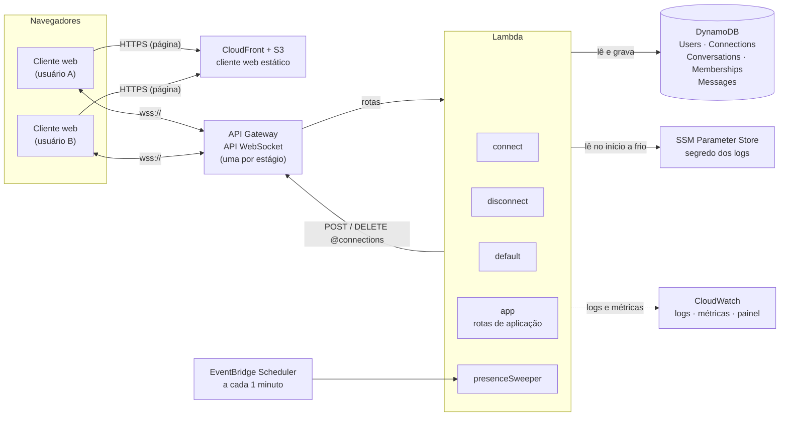
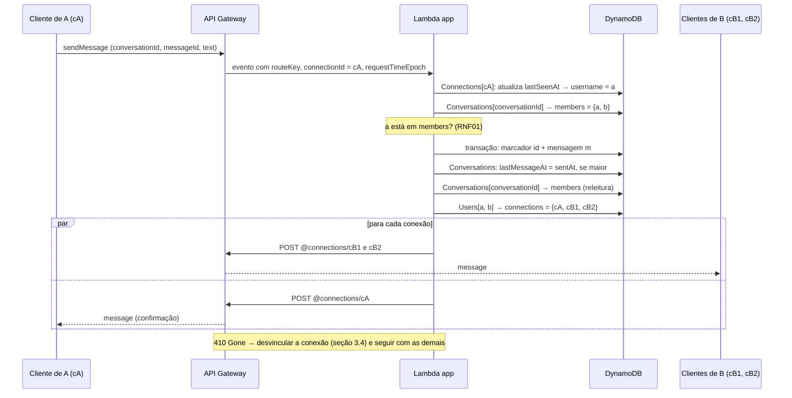

# Arquitetura distribuída e esquema de nomeação

**Projeto:** Hub Colaborativo WebSocket

## 1. Introdução

Este documento define a arquitetura distribuída do Hub Colaborativo WebSocket e o esquema de nomeação e endereçamento: como um usuário ou uma conversa é resolvido nas conexões WebSocket abertas e como uma requisição chega ao backend e volta aos clientes. Os requisitos citados (RF, RNF, R e L) estão na [especificação](especificacao.md).

O ciclo de vida da sessão, com os diagramas de sequência de `$connect` e `$disconnect`, fica para o documento da fase 3.

Os IDs das decisões (D) são estáveis, e o número de um item removido não é reaproveitado.

## 2. Arquitetura



| Componente | Papel |
| --- | --- |
| Cliente web | Aplicação Angular servida pelo CloudFront a partir de um bucket S3 (RNF07). Abre uma conexão WebSocket por aba, envia as requisições e mantém a fila de reenvio (RF12) e o heartbeat (RF08). |
| API Gateway | API WebSocket com a route selection expression `$request.body.action`. Encaminha cada rota a uma Lambda e expõe a Management API (`@connections`) para o envio aos clientes. |
| Lambda `connect` | Rota `$connect`: valida o nome de usuário, vincula a conexão ao usuário e anuncia a mudança aos contatos (RF01, RF07). |
| Lambda `disconnect` | Rota `$disconnect`: desvincula a conexão e anuncia a mudança aos contatos (RF01, RF07). |
| Lambda `default` | Rota `$default`: responde com erro às requisições sem rota (RF09). |
| Lambda `app` | Todas as rotas de aplicação (seção 4), escolhidas internamente pelo `routeKey`. |
| Lambda `presenceSweeper` | Acionada a cada minuto pelo EventBridge Scheduler; desvincula as conexões sem requisições há 10 minutos (RF07, R01), refaz os anúncios interrompidos por falha e publica o número de conexões abertas (seções 3.4, 3.5 e 5). |
| DynamoDB | Diretório de nomes (usuários e conexões), conversas, participações e mensagens (seção 3.3). |
| SSM Parameter Store | Segredo usado para anonimizar os identificadores nos logs (seção 5). |
| CloudWatch | Logs com identificadores anonimizados (RNF03), métricas e painel (RNF06). |

As Lambdas são escritas em TypeScript, no runtime Node.js, e empacotadas pelo CDK. Elas têm tempo limite de 10 s, do qual depende a sobreposição da reconexão (seção 4.4), exceto o `presenceSweeper`, com 50 s (seção 3.4). Todas recebem permissão de leitura e gravação nas tabelas, `execute-api:ManageConnections` no estágio (R04) e `ssm:GetParameter` no segredo dos logs; o `presenceSweeper` recebe também `cloudwatch:PutMetricData`.

Toda a infraestrutura é declarada no stack do AWS CDK em `backend/` (RNF05). Há um stack por estágio, `dev` para desenvolvimento e `prod` para a apresentação, cada um com a própria API, as próprias Lambdas e as próprias tabelas, na região `sa-east-1` (D07).

As configurações de teste da especificação ficam fora do estágio `prod`. As do backend são variáveis de ambiente definidas só no stack `dev`: responder com erro (T2, passo 6) e omitir a confirmação ao remetente na primeira tentativa de cada mensagem, o que simula uma confirmação que demora e leva ao reenvio (T2, passo 7). A do cliente, desligar o heartbeat (T7, passo 4), é uma opção do cliente executado localmente, apontado para o stack `dev`; os passos com configuração de teste usam esse cliente.

## 3. Esquema de nomeação e endereçamento

### 3.1 Nomes

O cronograma fala em *userId* e *sala*; neste projeto, eles correspondem ao nome de usuário (`username`) e à conversa (`conversationId`).

| Nome | Quem gera | Formato | Escopo e duração | Identifica |
| --- | --- | --- | --- | --- |
| `username` | o usuário, no `$connect` | `^[a-z0-9._-]{3,32}$`, convertido para minúsculas | único no estágio; permanente | o usuário |
| `displayName` | o usuário, no `$connect` | 1 a 50 caracteres, sem espaços nas pontas | o do último `$connect` (RF01) | nada; é só um rótulo |
| `connectionId` | o API Gateway | opaco | uma conexão; até 2 horas (L02) | o ponto de entrega de uma aba |
| `conversationId` | o backend | chat privado: `d:<username1>:<username2>`, em ordem alfabética; grupo: `g:<UUID v4>` | permanente | a conversa |
| `messageId` | o cliente | UUID v4 | único por remetente | a mensagem do remetente, inclusive nos reenvios (RF12) |
| `requestId` | o cliente | UUID v4 | uma requisição | a requisição, para associar a ela a resposta ou o erro (RF09) |

O `:` e o `#` não são aceitos no nome de usuário, e o backend recusa um `messageId` fora do formato (RF09); assim, nem um `conversationId` nem uma chave de mensagem (seção 3.3) é ambíguo. O nome de exibição não identifica nada, porque se repete entre usuários (RF05) e muda a cada conexão (RF01).

### 3.2 Resolução

O backend resolve nomes nos dois sentidos:

```text
envio aos clientes (fan-out):
  conversationId ──Conversations.members──► usernames ──Users.connections──► connectionIds ──► URI @connections

requisição recebida:
  connectionId (do requestContext) ──Connections.username──► username ──► autorização (RNF01)
```

A URI de uma conexão não é guardada; ela é derivada do `connectionId` e da URL de callback do estágio, que o CDK entrega às Lambdas pela variável de ambiente `CALLBACK_URL`:

```text
CALLBACK_URL = https://{api-id}.execute-api.sa-east-1.amazonaws.com/{estágio}
URI          = {CALLBACK_URL}/@connections/{connectionId}
```

O backend usa `POST` (`postToConnection`) para entregar eventos e `DELETE` (`deleteConnection`) para encerrar conexões no `presenceSweeper`. Um `POST` para uma conexão que não existe mais responde `410 Gone` (`GoneException`), e o backend desvincula a conexão (seção 3.4).

O backend nunca confia em um nome de usuário vindo no corpo de uma requisição. O usuário de cada requisição é sempre o que está vinculado ao `connectionId`, que o API Gateway informa e o cliente não consegue falsificar.

### 3.3 Diretório (DynamoDB)

As tabelas usam cobrança sob demanda. Todas as leituras são fortemente consistentes, e nenhuma usa índice secundário (D04), então uma conexão, um membro ou uma mensagem recém-gravados sempre aparecem na leitura seguinte.

**Connections**: conexão → usuário.

| Atributo | Tipo | Descrição |
| --- | --- | --- |
| `connectionId` | S (PK) | identificador da conexão |
| `username` | S | usuário vinculado |
| `connectedAt` | N | instante do `$connect`, em ms |
| `lastSeenAt` | N | instante da última requisição, em ms (RF07) |
| `expiresAt` | N (TTL) | `connectedAt` + 3 horas; só faxina de registros esquecidos |

**Users**: usuário → conexões.

| Atributo | Tipo | Descrição |
| --- | --- | --- |
| `username` | S (PK) | nome de usuário |
| `displayName` | S | nome de exibição atual |
| `connections` | SS | `connectionId`s abertos; ausente quando o usuário está offline |
| `version` | N | versão do usuário, incrementada a cada alteração de `connections` ou de `displayName` (seção 3.5) |
| `changedAt` | N | instante da última alteração de `version` |
| `announcedVersion` | N | última versão anunciada aos contatos, 0 na criação do usuário (seção 3.5) |

**Conversations**: conversa → membros.

| Atributo | Tipo | Descrição |
| --- | --- | --- |
| `conversationId` | S (PK) | identificador da conversa |
| `type` | S | `direct` ou `group` |
| `name` | S | nome do grupo; ausente no chat privado |
| `members` | SS | nomes de usuário dos membros |
| `started` | BOOL | chat privado: já tem mensagem (RF10) |
| `lastMessageAt` | N | instante da última mensagem |

**Memberships**: usuário → conversas (RF10).

| Atributo | Tipo | Descrição |
| --- | --- | --- |
| `username` | S (PK) | membro |
| `conversationId` | S (SK) | conversa |
| `hidden` | BOOL | só na participação do outro usuário em um chat privado sem mensagens, que ainda não aparece para ele (D11) |

**Messages**: histórico de cada conversa (RF06).

| Atributo | Tipo | Descrição |
| --- | --- | --- |
| `conversationId` | S (PK) | conversa |
| `sk` | S (SK) | mensagem: `m#<sentAt com 13 dígitos>#<sender>#<messageId>`; marcador de duplicata: `id#<sender>#<messageId>` |
| `messageId` | S | identificador gerado pelo cliente |
| `sender` | S | nome de usuário do remetente |
| `text` | S | texto |
| `sentAt` | N | `requestContext.requestTimeEpoch`: o instante em que o API Gateway recebeu a requisição (RF02) |
| `ref` | S | só no marcador de duplicata: o `sk` da mensagem original |

As consultas ao histórico se restringem ao prefixo `m#`, para não trazer os marcadores.

Os membros de uma conversa ficam em `Conversations.members`, lido em uma única leitura consistente; a tabela `Memberships` existe para listar as conversas de um usuário. As duas são alteradas juntas, em uma transação (seção 4.5).

As transações envolvem só `Conversations`, `Memberships` e `Messages`. Uma gravação nessas tabelas que encontra uma transação em andamento sobre o mesmo item falha com `TransactionConflict`, e uma transação que encontra outra falha da mesma forma. O backend repete a gravação após uma espera curta, até 3 vezes. Se o conflito persistir, a requisição recebe o erro `conflict` (RF09), exceto o envio de mensagem, que tem tratamento próprio (seção 4.3).

### 3.4 Vínculo e desvínculo de conexões

**Vincular** (`$connect`):

1. Validar `username` e `displayName` da query string; sem nome de usuário válido ou com nome de exibição inválido, a Lambda responde `400` e o handshake falha (RF01). Sem nome de exibição, vale o nome de usuário.
2. Gravar `Connections[connectionId]`, com `lastSeenAt` igual a `connectedAt`.
3. Em `Users[username]`, adicionar o `connectionId` ao conjunto `connections` (`ADD`), gravar o `displayName`, incrementar `version` e gravar `changedAt`, pedindo os valores novos. Na primeira conexão, a mesma atualização cria o usuário, com `announcedVersion` igual a 0.
4. Anunciar o estado do usuário aos contatos (seção 3.5). Uma falha nesse passo fica no log e não derruba o handshake, porque o anúncio é refeito pelo `presenceSweeper`.

O `$connect` não envia nada à conexão que está abrindo, porque o API Gateway só aceita `postToConnection` para ela depois que o handshake termina; os contatos, cujas conexões já estão abertas, podem ser avisados. Por isso, o cliente pede o próprio estado inicial (conversas e presença dos contatos) com a requisição `sync` logo após abrir a conexão.

**Desvincular** é um procedimento único, chamado pelo `$disconnect`, pelo `GoneException` no fan-out (RF08) e pelo `presenceSweeper` (RF07):

1. Ler `Connections[connectionId]` para obter o `username`. Se não há item, a conexão já foi desvinculada, e o procedimento termina. No fan-out, o `username` já é conhecido, e o procedimento segue para o passo 2 mesmo sem o item. Também no fan-out, um item com `connectedAt` de menos de 30 s encerra o procedimento: o id entra no conjunto antes de o handshake terminar, e um `postToConnection` nesse intervalo também responde `410`. Se a conexão de fato caiu, o `$disconnect` ou o `presenceSweeper` a desvincula.
2. Em `Users[username]`, remover o `connectionId` do conjunto (`DELETE`) com a condição `contains(connections, :connectionId)`, incrementar `version` e gravar `changedAt`, pedindo os valores novos. Se o conjunto ficou vazio, o DynamoDB remove o atributo. Se a condição falha, outro caminho já removeu o id, e o procedimento pula para o passo 4.
3. Anunciar o estado do usuário aos contatos (seção 3.5).
4. Apagar `Connections[connectionId]`.

Operações `ADD` e `DELETE` sobre um conjunto são atômicas, então conexões de abas diferentes do mesmo usuário não se atropelam, e a condição do passo 2 faz com que cada id seja removido uma única vez, mesmo com os três caminhos em paralelo.

A ordem dos passos mantém uma regra: todo id em `Users.connections` tem um item em `Connections`, porque o vínculo grava o item antes de incluir o id, e o desvínculo retira o id antes de apagar o item (D09). Assim, uma falha no meio sempre deixa um item em `Connections`, que o `presenceSweeper` encontra quando o `lastSeenAt` passa de 10 minutos:

- Falha no vínculo antes do passo 3: sobra um item fora do conjunto, que o `presenceSweeper` apaga; a condição do passo 2 falha, e nada é anunciado.
- Falha no vínculo depois do passo 3, como um tempo limite: o handshake falha, mas o id fica no conjunto, e o usuário aparece online até o `presenceSweeper` desvinculá-lo.
- Falha no desvínculo depois do passo 2: o `presenceSweeper` refaz o desvínculo, a condição falha, e o item é apagado. Um anúncio que tenha faltado é refeito pela regra da seção 3.5.

O TTL de `Connections` só alcança itens que o `presenceSweeper` não conseguiu tratar. Se ele apagar um item cujo id ainda está no conjunto, o id sai no próximo fan-out que receber `410` ou na varredura de `Users` do `presenceSweeper` (seção 3.5). Nessa varredura, cada id do conjunto sem item em `Connections` é conferido com uma leitura de `Connections[connectionId]` logo antes de ser desvinculado a partir do passo 2. Como o vínculo grava o item antes de incluir o id, essa leitura nunca toma por órfã uma conexão que está abrindo; a varredura em si não basta, porque um `Scan` não é um retrato de um único instante.

**Expiração por inatividade** (RF07): toda requisição, de qualquer rota exceto `$connect` e `$disconnect` (inclusive `heartbeat`, `sync`, `search` e as que caem na `$default`), atualiza `Connections.lastSeenAt` com a condição `attribute_exists(connectionId)`, que impede recriar o item de uma conexão já desvinculada. A mesma atualização devolve o item e, com ele, o `username` (seção 3.2). Se a condição falha, a conexão não tem mais registro: a Lambda a encerra com `DELETE @connections`, sem executar a requisição, e o cliente se reconecta (RF08).

O `presenceSweeper` lê as conexões com `lastSeenAt` de mais de 10 minutos atrás, encerra cada uma com `DELETE @connections`, ignorando qualquer erro, porque a conexão pode já ter caído, e a desvincula. O agendamento tem resolução de 1 minuto e pode atrasar alguns segundos, então cada execução faz duas varreduras de `Connections`, no início e 30 s depois, e a varredura de `Users` da seção 3.5; por isso o tempo limite dessa Lambda é de 50 s. O offline é anunciado, assim, entre 10 e 11 minutos após a última requisição. O agendamento não faz novas tentativas de uma execução que falhou, porque o disparo seguinte refaz o mesmo trabalho. O TTL do DynamoDB não serve para isso, porque apaga os itens sem prazo garantido e sem avisar ninguém (D05).

Nos passos 1 e 2 do T7, regravar o registro de uma conexão significa gravar de novo o item em `Connections`, com o `connectedAt` original e o `lastSeenAt` de agora, e devolver o `connectionId` ao conjunto em `Users`, como no vínculo.

### 3.5 Contatos e anúncios

Os anúncios de presença (RF07) e de nome de exibição (RF01) vão aos *contatos* do usuário: os membros de todas as conversas em que ele tem participação, visível ou oculta (D11). A resolução é `Memberships[username]` → `Conversations.members` de cada conversa → `Users.connections` de cada contato. O cliente pode receber o anúncio de um usuário que ainda não aparece em nenhuma das suas conversas, como o de quem abriu com ele um chat privado ainda sem mensagens; ele guarda o último anúncio de cada usuário, conhecido ou não, para não ficar com um estado mais antigo quando esse usuário aparecer.

Anunciar é enviar aos contatos o evento `presence` com o estado atual do usuário (`online`, se o conjunto `connections` não está vazio, e `displayName`) e a `version` devolvida pela alteração; depois, gravar `announcedVersion` com essa versão, se for maior que a gravada. Toda alteração é anunciada, mesmo a que não muda o que os contatos veem, como a abertura de uma segunda aba. O cliente aplica um anúncio só se a versão for maior que a última que tem daquele usuário, e, como as alterações de um mesmo item são serializadas pelo DynamoDB, um anúncio atrasado nunca desfaz um mais novo (D10).

Se a Lambda falha antes de anunciar, `announcedVersion` fica menor que `version`. A cada execução, o `presenceSweeper` percorre `Users`, procura os usuários nessa situação com `changedAt` de mais de 1 minuto atrás e anuncia o estado atual deles. O atraso de 1 minuto evita refazer o anúncio de uma Lambda que ainda está em andamento, e um anúncio repetido não tem efeito, porque leva a mesma versão.

## 4. Roteamento de requisições

### 4.1 Rotas

O API Gateway escolhe a rota pelo campo `action` da requisição (route selection expression `$request.body.action`). Toda requisição de aplicação leva também um `requestId`.

| Rota (`action`) | Lambda | Campos | Requisitos |
| --- | --- | --- | --- |
| `$connect` | connect | query string: `username`, `displayName` | RF01 |
| `$disconnect` | disconnect | — | RF01, RF07 |
| `$default` | default | — | RF09 |
| `sync` | app | `since` (opcional, instante em ms) | RF07, RF08, RF10 |
| `heartbeat` | app | — | RF07, RF08 |
| `sendMessage` | app | `conversationId`, `messageId`, `text` | RF02, RF11, RF12 |
| `openDirect` | app | `username` | RF03 |
| `createGroup` | app | `name`, `members` | RF04 |
| `addMember` | app | `conversationId`, `username` | RF04 |
| `leaveGroup` | app | `conversationId` | RF04 |
| `getHistory` | app | `conversationId` e, opcionalmente, `before` ou `after` (um limite de `sk`) | RF06, RF08 |
| `search` | app | `query` | RF05 |

Exemplo:

```json
{
  "action": "sendMessage",
  "requestId": "0b6d2c1e-7f0e-4a51-9d3a-1c2f6a8e4b77",
  "conversationId": "d:antonio:wallyson",
  "messageId": "5f3c9a10-2b7d-4e8f-a6c1-9d0e7b4a2f13",
  "text": "Olá!"
}
```

Em toda requisição, a Lambda `app` atualiza `lastSeenAt` e resolve o usuário pela conexão (seções 3.2 e 3.4); a Lambda `default` faz o mesmo antes de responder com erro. Antes de qualquer ação sobre uma conversa, a Lambda `app` confere também se o usuário está em `Conversations.members` (RNF01).

### 4.2 Eventos enviados ao cliente

Tudo o que o cliente recebe, inclusive as respostas às próprias requisições, chega por `postToConnection` (D06). Todo evento tem um campo `type`.

| `type` | Quando | Campos principais |
| --- | --- | --- |
| `response` | resposta a uma requisição | `requestId`, `data` |
| `error` | requisição recusada (RF09) | `requestId` (quando houver), `messageId` (quando a requisição é uma mensagem, RF12), `code`, `message` |
| `pong` | resposta ao heartbeat | `requestId` |
| `message` | nova mensagem em uma conversa (RF02) | `conversationId`, `sk`, `messageId`, `sender`, `text`, `sentAt` |
| `presence` | anúncio do estado de um contato (RF01, RF07) | `username`, `displayName`, `online`, `version` |
| `conversationAdded` | conversa nova visível (RF10) | `conversation`, com os membros e o estado de cada um |
| `conversationRemoved` | saída de um grupo (RF04) | `conversationId` |
| `memberJoined` | entrada de membro (RF04, RF07) | `conversationId` e o estado do novo membro |
| `memberLeft` | saída de membro (RF04) | `conversationId`, `username` |

O estado de um usuário é sempre o mesmo conjunto de campos: `username`, `displayName`, `online` e `version`. Ele acompanha cada membro em `conversationAdded`, em `memberJoined` e nas respostas de `sync`, `openDirect` e `createGroup`, e cada usuário no resultado de `search`. Assim, o cliente recebe a presença de quem surge em uma das suas conversas (RF07) e compara pela versão o estado dessas respostas com o dos anúncios (seção 3.5). O backend lê esses estados depois de gravar a participação que torna os usuários contatos; uma mudança posterior à leitura já encontra a participação gravada e é anunciada ao novo contato.

O `code` de um erro é um de: `invalidRequest` (campo ausente ou fora do formato), `unknownAction` (requisição na `$default`), `forbidden` (o usuário não participa da conversa, RNF01), `notFound` (usuário inexistente), `invalidOperation` (ação não permitida, como adicionar quem já é membro) e `conflict` (seção 3.3). O `message` diz, em texto, o que falhou (RF09).

Quando uma Lambda falha ou passa do tempo limite, o API Gateway pode enviar ao cliente a própria mensagem de erro, sem `type` e sem o `requestId` do cliente. O cliente a registra e não a associa a nenhuma requisição, e uma mensagem pendente continua na fila (RF12).

Um evento `message` de uma conversa que o cliente ainda não conhece pode chegar antes do `conversationAdded` dela (seção 4.3); nesse caso, o cliente pede `sync` em vez de descartar a mensagem.

### 4.3 Roteamento de uma mensagem



1. A Lambda resolve o remetente pelo `connectionId`, lê a conversa e confere se ele é membro dela.
2. Grava, em uma única transação, o marcador `id#<sender>#<messageId>` (com a condição de que ainda não exista) e a mensagem `m#<sentAt>#<sender>#<messageId>`. Como o marcador inclui o remetente, outro usuário pode usar o mesmo `messageId` sem que sua mensagem seja tomada por um reenvio (T7).
3. Se a transação é cancelada:
   - Por `ConditionalCheckFailed` no marcador, é um reenvio da fila do cliente (RF12, R07). A Lambda lê o marcador e, pelo `ref`, a mensagem original, refaz os passos 4 e 5 com ela, que não têm efeito se já foram feitos, e a envia só à conexão que reenviou, como confirmação.
   - Por `TransactionConflict`, outra transação sobre o mesmo marcador está em andamento: a do original de um reenvio, ou o contrário. A Lambda repete a transação (seção 3.3). Se o conflito persistir, lê o marcador: se ele existe, segue como reenvio; se não, não responde, e a mensagem continua pendente no cliente, que a reenvia (seção 4.4). A requisição não se perde, porque o reenvio conclui o trabalho; responder com erro a tiraria da fila (RF12), embora a transação concorrente ainda possa gravá-la.
4. Atualiza `Conversations.lastMessageAt` para o `sentAt`, com a condição de que o valor atual seja menor ou ausente, e ignora a falha da condição. Essa gravação fica fora da transação para que envios simultâneos na mesma conversa não entrem em conflito no item da conversa (R06, T8).
5. Se `started` ainda é falso (chat privado sem mensagens), a Lambda torna visíveis as participações ocultas da conversa, removendo `hidden` de cada uma com a condição de que ele exista, e marca `started`. Normalmente a oculta é a do outro usuário, mas também pode ser a do remetente, se ele envia sem ter aberto a conversa. Para cada participação que torna visível, a Lambda que vence a condição envia `conversationAdded` ao dono dela, antes da mensagem (RF10), então duas primeiras mensagens simultâneas não geram o aviso em dobro. Se o outro usuário já tinha aberto a conversa, a participação dele não está oculta, e ninguém envia o aviso.
6. Relê `Conversations.members`, resolve as conexões de todos os membros e envia o evento `message` a cada uma, em paralelo. Um `410 Gone` desvincula aquela conexão e não interrompe as demais (RF08). A releitura acontece depois da transação, então um membro adicionado no meio do envio ou entra nesse fan-out, ou carrega o histórico depois que a mensagem já foi gravada.

Se um conflito persistir nos passos 4 ou 5, a Lambda não envia a mensagem nem a confirma, e o reenvio da fila refaz esses passos. Refazê-los no reenvio também cobre uma Lambda que falha depois da transação: sem isso, `lastMessageAt` poderia ficar desatualizado, e uma participação, oculta. Nesses casos, a mensagem em si não é entregue de novo aos demais (RF12); eles a recebem pelo histórico (seção 7).

### 4.4 Ordem e reconexão

A ordem de uma conversa é a ordem do `sk` (`sentAt` e, no empate, remetente e `messageId`). O cliente insere cada mensagem recebida na posição do `sk` e descarta uma mensagem que já tem (mesmo remetente e `messageId`), então todos os clientes exibem a mesma ordem (RNF04), mesmo que as entregas de duas Lambdas cheguem em ordem diferente.

O cliente envia `heartbeat` a cada 30 s e, sem `pong` em 10 s, considera a conexão perdida e se reconecta com backoff exponencial (RF08).

Ao reconectar, o cliente envia `sync` com `since` igual ao maior entre o `sentAt` da última mensagem que recebeu e o instante do último `sync`, que a resposta traz, menos 30 segundos; na primeira conexão, sem `since`. O `sync` aponta as conversas com `lastMessageAt` posterior a ele. Para cada uma, o cliente pede `getHistory` com `after` igual ao último `sk` que tem, recuado também em 30 segundos, ou, se não tem nenhuma mensagem dela, sem `after`. A sobreposição cobre uma mensagem gravada depois de outra com `sentAt` maior: o `sentAt` é o instante em que o API Gateway recebeu a requisição, e a gravação pode acontecer até o fim do início a frio e do tempo limite de 10 s da Lambda `app`. As repetidas são descartadas pelo remetente e `messageId`, e nada se perde nem aparece duas vezes.

Uma mensagem sem confirmação em 15 s é reenviada (RF12). As pendentes são reenviadas uma por vez, cada uma após a confirmação da anterior; reenviadas juntas, duas mensagens poderiam ter o mesmo `sentAt`, e o desempate pelo `messageId` inverteria a ordem original.

O histórico é enviado em páginas de até 50 mensagens e até 28 KB, com pelo menos uma mensagem por página, para que uma mensagem grande não trave a paginação. A tabela de cotas diz que uma mensagem acima de 32 KB precisa ser dividida em frames e que isso vale para os comandos `@connections`, mas não diz se o API Gateway faz essa divisão em um `postToConnection`; o T5 mostra o comportamento real (RF06).

### 4.5 Demais rotas

- **`heartbeat`:** atualiza `lastSeenAt` e responde `pong`.
- **`sync`:** responde com o instante da requisição e com as conversas em que o usuário tem participação visível, cada uma com tipo, nome, membros com o estado de cada um (seção 4.2) e `lastMessageAt`, e marca as que têm `lastMessageAt` maior que `since` (seção 4.4).
- **`openDirect`:** recusa o próprio usuário (`invalidOperation`) e um usuário inexistente (`notFound`). Em uma transação com a condição de que a conversa ainda não exista, grava a conversa `d:…` com `started` falso, a participação de quem abriu e a do outro usuário, oculta. Se a conversa já existe (RF03), torna visível a participação de quem abriu, caso esteja oculta. Responde com a conversa.
- **`createGroup`:** o nome segue a regra do nome de exibição. A Lambda retira de `members` o criador e as repetições, exige pelo menos um usuário (RF04) e recusa usuários inexistentes (`notFound`, com os nomes). Em uma transação, grava a conversa `g:<UUID v4>` e a participação de cada membro, o que limita a criação a 99 membros, incluindo o criador. Envia `conversationAdded` a todas as conexões dos membros, inclusive às do criador, e responde com a conversa.
- **`addMember`:** só vale em grupo (`invalidOperation` no chat privado) e recusa um usuário inexistente (`notFound`) ou que já é membro (`invalidOperation`). Em uma transação, inclui o usuário em `Conversations.members`, com a condição de que quem adiciona ainda seja membro e o novo ainda não seja, e grava a participação dele. Envia `memberJoined` às conexões dos membros anteriores e `conversationAdded` às do novo membro, que passa a ler todo o histórico (RF04).
- **`leaveGroup`:** só vale em grupo (`invalidOperation` no chat privado). Em uma transação, retira o usuário de `Conversations.members`, com a condição de que ele seja membro, e apaga a participação. Envia `conversationRemoved` a todas as conexões de quem saiu e `memberLeft` às dos que ficaram. Um grupo de que todos saíram fica sem membros e inacessível.
- **`getHistory`:** sem `before` nem `after`, responde com a página mais recente; com `before`, com a página anterior a esse limite; com `after`, com a seguinte. Os dois juntos são recusados (`invalidRequest`). A resposta traz as mensagens em ordem de `sk` e indica se há mais.
- **`search`:** compara a `query`, sem diferenciar maiúsculas, com o nome das conversas em que o usuário tem participação visível (o nome do grupo ou o nome de exibição do outro usuário) e com o nome de usuário e o nome de exibição dos demais usuários. A comparação é feita na Lambda, sobre a leitura completa de `Users` (seção 7), e cada usuário encontrado vem com o seu estado (RF05, RF07).

## 5. Logs e métricas

Cada Lambda escreve uma linha JSON por requisição (RNF03) com a rota, o resultado, o código de erro e a duração. Os identificadores (`connectionId`, `username` e `conversationId`) aparecem anonimizados como os 12 primeiros caracteres hexadecimais de `HMAC-SHA256(segredo, valor)`. O segredo fica no SSM Parameter Store e é o mesmo em todas as Lambdas do estágio, então um mesmo identificador gera sempre o mesmo valor anonimizado e os logs continuam correlacionáveis. O texto das mensagens nunca é registrado.

O segredo é um parâmetro `SecureString` criado uma vez por estágio, fora do CDK, porque o CloudFormation não cria parâmetros desse tipo e o valor não pode ficar no repositório. O stack só referencia o parâmetro pelo nome e concede a leitura; cada Lambda o lê no início a frio. O parâmetro é cifrado com a chave gerenciada pela AWS para o SSM (`aws/ssm`), e não com uma chave gerenciada pelo cliente; a política dessa chave não pode ser alterada e já permite o uso pelo SSM às identidades da conta, então basta `ssm:GetParameter`, sem `kms:Decrypt`.

O painel (RNF06) usa as métricas que o API Gateway publica para a API WebSocket (`ConnectCount`, `MessageCount`, `IntegrationError`, `ClientError`, `ExecutionError` e `IntegrationLatency`) e as métricas das Lambdas. O API Gateway não publica o número de conexões abertas, então o `presenceSweeper`, que já percorre `Connections` a cada minuto, publica essa contagem como métrica própria.

## 6. Decisões

- **D01 – Lambda e DynamoDB:** backend sem servidor, sem VPC e com cobrança por uso, que é a arquitetura mínima do tema. Um Redis guardaria o diretório com menor latência, mas exigiria VPC e um nó sempre ligado.
- **D02 – Uma Lambda para as rotas de aplicação:** as rotas de aplicação compartilham a mesma Lambda `app`, o que reduz os inícios a frio (R05) e o código repetido. `$connect`, `$disconnect` e `$default` ficam em Lambdas próprias, porque têm entradas e permissões diferentes. O log registra o `routeKey`, então as rotas continuam distinguíveis (RNF03).
- **D03 – `conversationId` determinístico no chat privado:** `d:<username1>:<username2>` em ordem alfabética garante um único chat por par (RF03) com a transação condicional do `openDirect` (seção 4.5), mesmo que os dois usuários o iniciem ao mesmo tempo.
- **D04 – Conjuntos no item em vez de índices secundários:** os índices secundários globais do DynamoDB só têm leitura eventualmente consistente, e uma conexão recém-aberta ou um membro recém-adicionado poderia ficar de fora de um fan-out. Os conjuntos `Users.connections` e `Conversations.members` são lidos de forma consistente e alterados atomicamente. Isso vale enquanto os conjuntos forem pequenos (o item tem limite de 400 KB), o que é o caso do projeto.
- **D05 – `presenceSweeper` em vez de TTL:** o RF07 exige anunciar o offline em até 1 minuto, e o TTL do DynamoDB não tem prazo nem gera aviso. O TTL fica só como faxina.
- **D06 – Todos os eventos por `@connections`:** as respostas às requisições também usam `postToConnection`, em vez da resposta da integração da rota. O cliente tem um único caminho de recebimento, e o custo é uma chamada a mais por requisição.
- **D07 – Região `sa-east-1`:** os clientes e a demonstração estão no Brasil, e a região de São Paulo reduz a latência de rede (RNF02).
- **D08 – Cliente no S3 com CloudFront:** o cliente estático fica no mesmo stack do CDK que o backend (RNF05) e é servido por HTTPS (RNF07).
- **D09 – Desvínculo em passos ordenados em vez de transação:** uma transação no DynamoDB não devolve os valores gravados, e o anúncio precisa do conjunto e da versão resultantes. A ordem dos passos (seção 3.4) mantém todo id do conjunto com um item em `Connections`, e uma falha no meio fica para o `presenceSweeper` terminar.
- **D10 – Versão do usuário nos anúncios em vez de horário:** um horário viria do relógio de Lambdas diferentes, medido depois da gravação, e um offline gravado antes de um online poderia sair com horário maior e prevalecer. A versão é incrementada na mesma atualização que altera o usuário, e as atualizações de um item são serializadas, então ela segue a ordem real das alterações.
- **D11 – Participação oculta no chat privado:** o RF10 só mostra o chat ao outro usuário na primeira mensagem, mas o RF07 exige que quem abriu o chat receba desde já a presença do outro. A participação oculta faz dos dois contatos um do outro sem mostrar a conversa antes da hora.

## 7. Limitações do esquema

- A pesquisa de usuários (RF05) e o `presenceSweeper` percorrem tabelas inteiras (`Scan`). Com o número de usuários do projeto isso é barato; com muitos usuários, seriam necessários um índice de pesquisa, um índice por `lastSeenAt` e outro para os anúncios pendentes.
- O fan-out faz uma chamada por conexão de cada destinatário (R06). O custo cresce com o tamanho do grupo e com o número de abas abertas.
- A conferência de participação (RNF01) acontece antes da gravação da mensagem, e não na mesma transação, para que envios simultâneos na mesma conversa não entrem em conflito no item da conversa. Uma mensagem enviada no mesmo instante em que o remetente sai do grupo ainda pode ser gravada e entregue.
- Se a Lambda falha entre tornar visível a participação do outro usuário e enviar o `conversationAdded`, a conversa só aparece para ele no próximo `sync` (RF10).
- Se a Lambda falha depois de gravar a mensagem e antes do fan-out, ou se um conflito persiste nos passos 4 e 5 da seção 4.3, o reenvio só confirma ao remetente, e os demais participantes veem a mensagem ao abrir a conversa ou ao reconectar, e não em tempo real.
- Uma conta nova da AWS pode ter uma cota baixa de execuções simultâneas de Lambda. Ela deve ser conferida, e aumentada se preciso, antes do T8, em que os envios simultâneos e os heartbeats somam execuções.
- Uma mensagem perto do limite do RF11 gera um evento `message` acima de 32 KB. Se o API Gateway não dividir em frames os envios por `@connections` (seção 4.4), o limite do RF11 terá de baixar; o T2 e o T5 mostram o comportamento real.
