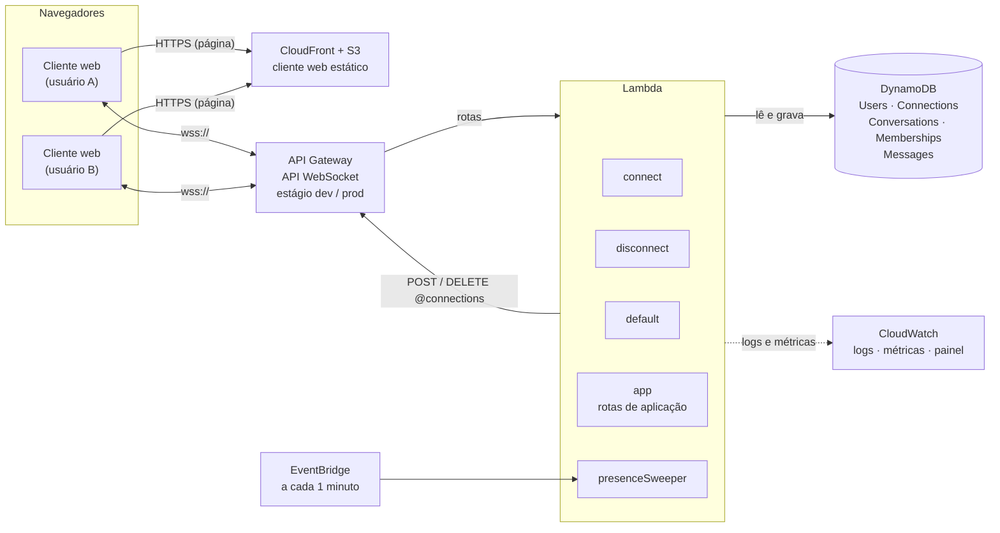
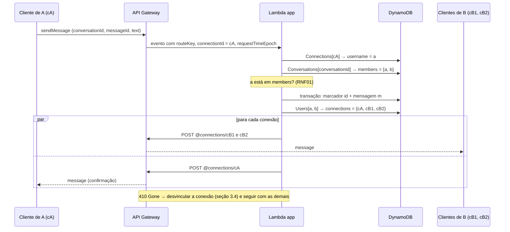

# Arquitetura distribuída e esquema de nomeação

**Projeto:** Hub Colaborativo WebSocket

## 1. Introdução

Este documento define a arquitetura distribuída do Hub Colaborativo WebSocket e o esquema de nomeação e endereçamento: como um usuário ou uma conversa é resolvido nas conexões WebSocket abertas e como uma requisição chega ao backend e volta aos clientes. Os requisitos citados (RF, RNF, R e L) estão na [especificação](especificacao.md).

O ciclo de vida da sessão, com os diagramas de sequência de `$connect` e `$disconnect`, fica para o documento da fase 3.

Os IDs das decisões (D) são estáveis, e o número de um item removido não é reaproveitado.

## 2. Arquitetura



| Componente | Papel |
| --- | --- |
| Cliente web | Aplicação Angular servida pelo CloudFront a partir de um bucket S3 (RNF07). Abre uma conexão WebSocket por aba, envia as requisições e mantém a fila de retentativa (RF02) e o heartbeat (RF08). |
| API Gateway | API WebSocket com a route selection expression `$request.body.action`. Encaminha cada rota a uma Lambda e expõe a Management API (`@connections`) para o envio aos clientes. |
| Lambda `connect` | Rota `$connect`: valida o nome de usuário e vincula a conexão ao usuário (RF01). |
| Lambda `disconnect` | Rota `$disconnect`: desvincula a conexão (RF01, RF07). |
| Lambda `default` | Rota `$default`: responde com erro às requisições sem rota (RF09). |
| Lambda `app` | Todas as rotas de aplicação (seção 4), escolhidas internamente pelo `routeKey`. |
| Lambda `presenceSweeper` | Acionada a cada minuto pelo EventBridge; desvincula as conexões sem requisições há 10 minutos (RF07, R01). |
| DynamoDB | Diretório de nomes (usuários e conexões), conversas, participações e mensagens (seção 3.3). |
| CloudWatch | Logs com identificadores anonimizados (RNF03), métricas e painel (RNF06). |

Toda a infraestrutura é declarada no stack do AWS CDK em `backend/` (RNF05). Há um stack por estágio, `dev` para desenvolvimento e `prod` para a apresentação, cada um com as próprias tabelas, na região `sa-east-1` (D07).

## 3. Esquema de nomeação e endereçamento

### 3.1 Nomes

O cronograma fala em *userId* e *sala*; neste projeto, eles correspondem ao nome de usuário (`username`) e à conversa (`conversationId`).

| Nome | Quem gera | Formato | Escopo e duração | Identifica |
| --- | --- | --- | --- | --- |
| `username` | o usuário, no `$connect` | `^[a-z0-9._-]{3,32}$`, convertido para minúsculas | único no estágio; permanente | o usuário |
| `displayName` | o usuário, no `$connect` | 1 a 50 caracteres, sem espaços nas pontas | o do último `$connect` (RF01) | nada; é só um rótulo |
| `connectionId` | o API Gateway | opaco | uma conexão; até 2 horas (L02) | o ponto de entrega de uma aba |
| `conversationId` | o backend | chat privado: `d:<username1>:<username2>`, em ordem alfabética; grupo: `g:<UUID v4>` | permanente | a conversa |
| `messageId` | o cliente | UUID v4 (`crypto.randomUUID()`) | único na conversa | a mensagem, inclusive nos reenvios (RF02) |
| `requestId` | o cliente | UUID v4 | uma requisição | a requisição, para associar a ela a resposta ou o erro (RF09) |

O `:` não é aceito no nome de usuário, então um `conversationId` nunca é ambíguo. O nome de exibição não identifica nada, porque se repete entre usuários (RF05) e muda a cada conexão (RF01).

### 3.2 Resolução

O backend resolve nomes nos dois sentidos:

```text
envio aos clientes (fan-out):
  conversationId ──Conversations.members──► usernames ──Users.connections──► connectionIds ──► URI @connections

requisição recebida:
  connectionId (do requestContext) ──Connections.username──► username ──► autorização (RNF01)
```

A URI de uma conexão não é guardada; ela é derivada do `connectionId` e da URL de callback do estágio, que o CDK entrega às Lambdas pela variável de ambiente `CALLBACK_URL`:

```text
CALLBACK_URL = https://{api-id}.execute-api.sa-east-1.amazonaws.com/{estágio}
URI          = {CALLBACK_URL}/@connections/{connectionId}
```

| Método na URI | Comando | Uso |
| --- | --- | --- |
| `POST` | `postToConnection` | entregar um evento ao cliente |
| `DELETE` | `deleteConnection` | encerrar a conexão (`presenceSweeper`) |
| `GET` | `getConnection` | consultar a conexão (diagnóstico) |

Um `POST` ou `DELETE` para uma conexão que não existe mais responde `410 Gone` (`GoneException`), e o backend desvincula a conexão (seção 3.4).

O backend nunca confia em um nome de usuário vindo no corpo de uma requisição. O usuário de cada requisição é sempre o que está vinculado ao `connectionId`, que o API Gateway informa e o cliente não consegue falsificar.

### 3.3 Diretório (DynamoDB)

As tabelas usam cobrança sob demanda. As leituras do diretório e dos membros são fortemente consistentes, para que uma conexão ou um membro recém-adicionado entre no próximo fan-out (D04).

**Connections**: conexão → usuário.

| Atributo | Tipo | Descrição |
| --- | --- | --- |
| `connectionId` | S (PK) | identificador da conexão |
| `username` | S | usuário vinculado |
| `connectedAt` | N | instante do `$connect`, em ms |
| `lastSeenAt` | N | instante da última requisição, em ms (RF07) |
| `expiresAt` | N (TTL) | `connectedAt` + 3 horas; só faxina de registros esquecidos |

**Users**: usuário → conexões.

| Atributo | Tipo | Descrição |
| --- | --- | --- |
| `username` | S (PK) | nome de usuário |
| `displayName` | S | nome de exibição atual |
| `connections` | SS | `connectionId`s abertos; ausente quando o usuário está offline |
| `createdAt` | N | primeira conexão |

**Conversations**: conversa → membros.

| Atributo | Tipo | Descrição |
| --- | --- | --- |
| `conversationId` | S (PK) | identificador da conversa |
| `type` | S | `direct` ou `group` |
| `name` | S | nome do grupo; ausente no chat privado |
| `members` | SS | nomes de usuário dos membros |
| `started` | BOOL | chat privado: já tem mensagem (RF10) |
| `lastMessageAt` | N | instante da última mensagem |

**Memberships**: usuário → conversas visíveis (RF10).

| Atributo | Tipo | Descrição |
| --- | --- | --- |
| `username` | S (PK) | membro |
| `conversationId` | S (SK) | conversa |
| `joinedAt` | N | entrada na conversa |

**Messages**: histórico de cada conversa (RF06).

| Atributo | Tipo | Descrição |
| --- | --- | --- |
| `conversationId` | S (PK) | conversa |
| `sk` | S (SK) | mensagem: `m#<sentAt com 13 dígitos>#<messageId>`; marcador de duplicata: `id#<messageId>` |
| `messageId` | S | identificador gerado pelo cliente |
| `sender` | S | nome de usuário do remetente |
| `text` | S | texto |
| `sentAt` | N | `requestContext.requestTimeEpoch`: o instante em que o API Gateway recebeu a requisição (RF02) |
| `ref` | S | só no marcador de duplicata: o `sk` da mensagem original |

Os membros de uma conversa ficam em `Conversations.members`, lido em uma única leitura consistente; a tabela `Memberships` existe para listar as conversas de um usuário. As duas são alteradas juntas, em uma transação.

### 3.4 Vínculo e desvínculo de conexões

**Vincular** (`$connect`):

1. Validar `username` e `displayName` da query string; sem nome de usuário válido, a Lambda responde `400` e o handshake falha (RF01). Sem nome de exibição, vale o nome de usuário.
2. Gravar `Connections[connectionId]`.
3. Em `Users[username]`, adicionar o `connectionId` ao conjunto `connections` (`ADD`) e gravar o `displayName`, pedindo os valores antigos. Se o conjunto antigo estava vazio, o usuário acabou de ficar online.
4. Se o usuário ficou online ou mudou de nome de exibição, avisar os contatos (seção 3.5).

O `$connect` não envia nada à conexão que está abrindo, porque o API Gateway só aceita `postToConnection` para ela depois que o handshake termina; os contatos, cujas conexões já estão abertas, podem ser avisados. Por isso, o cliente pede o próprio estado inicial (conversas e presença dos contatos) com a requisição `sync` logo após abrir a conexão.

**Desvincular** é um procedimento único, chamado pelo `$disconnect`, pelo `GoneException` no fan-out (RF08) e pelo `presenceSweeper` (RF07):

1. Apagar `Connections[connectionId]` pedindo o item antigo. Se não havia item, outro caminho já desvinculou a conexão, e o procedimento termina.
2. Em `Users[username]`, remover o `connectionId` do conjunto (`DELETE`). Se o conjunto ficou vazio, o DynamoDB remove o atributo, e o usuário acabou de ficar offline: anunciar aos contatos.

Como só um chamador consegue apagar o item no passo 1, cada conexão é desvinculada uma única vez, mesmo com os três caminhos em paralelo, e a mudança para offline é anunciada uma única vez. Operações `ADD` e `DELETE` sobre um conjunto são atômicas, então conexões de abas diferentes do mesmo usuário não se atropelam.

**Expiração por inatividade** (RF07): toda requisição atualiza `Connections.lastSeenAt`. A cada minuto, o `presenceSweeper` lê as conexões com `lastSeenAt` de mais de 10 minutos atrás, encerra cada uma com `DELETE @connections` (ignorando o `410`) e a desvincula. O offline é anunciado, assim, entre 10 e 11 minutos após a última requisição. O TTL do DynamoDB não serve para isso, porque apaga os itens sem prazo garantido e sem avisar ninguém (D05).

### 3.5 Contatos

Os avisos de presença (RF07) e de troca de nome de exibição (RF01) vão aos *contatos* do usuário: os membros de todas as conversas visíveis dele. A resolução é `Memberships[username]` → `Conversations.members` de cada conversa → `Users.connections` de cada contato.

## 4. Roteamento de requisições

### 4.1 Rotas

O API Gateway escolhe a rota pelo campo `action` da requisição (route selection expression `$request.body.action`). Toda requisição de aplicação leva também um `requestId`.

| Rota (`action`) | Lambda | Campos | Requisitos |
| --- | --- | --- | --- |
| `$connect` | connect | query string: `username`, `displayName` | RF01 |
| `$disconnect` | disconnect | — | RF01, RF07 |
| `$default` | default | — | RF09 |
| `sync` | app | `since` (opcional, instante em ms) | RF07, RF08, RF10 |
| `heartbeat` | app | — | RF07, RF08 |
| `sendMessage` | app | `conversationId`, `messageId`, `text` | RF02, RF11 |
| `openDirect` | app | `username` | RF03 |
| `createGroup` | app | `name`, `members` | RF04 |
| `addMember` | app | `conversationId`, `username` | RF04 |
| `leaveGroup` | app | `conversationId` | RF04 |
| `getHistory` | app | `conversationId`, `before` ou `after` (opcional, um `sk`) | RF06, RF08 |
| `search` | app | `query` | RF05 |

Exemplo:

```json
{
  "action": "sendMessage",
  "requestId": "0b6d2c1e-7f0e-4a51-9d3a-1c2f6a8e4b77",
  "conversationId": "d:antonio:wallyson",
  "messageId": "5f3c9a10-2b7d-4e8f-a6c1-9d0e7b4a2f13",
  "text": "Olá!"
}
```

Antes de qualquer ação sobre uma conversa, a Lambda `app` resolve o usuário pela conexão (seção 3.2), confere se ele está em `Conversations.members` (RNF01) e atualiza `lastSeenAt`.

### 4.2 Eventos enviados ao cliente

Tudo o que o cliente recebe, inclusive as respostas às próprias requisições, chega por `postToConnection` (D06). Todo evento tem um campo `type`.

| `type` | Quando | Campos principais |
| --- | --- | --- |
| `response` | resposta a uma requisição | `requestId`, `data` |
| `error` | requisição recusada (RF09) | `requestId` (quando houver), `code`, `message` |
| `pong` | resposta ao heartbeat | `requestId` |
| `message` | nova mensagem em uma conversa (RF02) | `conversationId`, `sk`, `messageId`, `sender`, `text`, `sentAt` |
| `presence` | mudança de presença de um contato (RF07) | `username`, `online`, `at` |
| `displayName` | troca de nome de exibição de um contato (RF01) | `username`, `displayName` |
| `conversationAdded` | conversa nova visível (RF10) | `conversation` |
| `conversationRemoved` | saída de um grupo (RF04) | `conversationId` |
| `memberJoined` / `memberLeft` | entrada ou saída de membro (RF04) | `conversationId`, `username` |

O evento `presence` leva o instante da mudança (`at`), e o cliente ignora um evento mais antigo que o último recebido para o mesmo usuário, já que dois avisos podem chegar fora de ordem.

### 4.3 Roteamento de uma mensagem



1. A Lambda resolve o remetente pelo `connectionId` e confere se ele é membro da conversa.
2. Grava, em uma única transação, o marcador `id#<messageId>` (com a condição de que ainda não exista) e a mensagem `m#<sentAt>#<messageId>`.
3. Se a condição falha, é um reenvio da fila de retentativa (RF02, R07): a Lambda lê a mensagem original pelo `ref` do marcador e a envia só à conexão que reenviou, como confirmação.
4. Senão, resolve as conexões de todos os membros e envia o evento `message` a cada uma, em paralelo. Um `410 Gone` desvincula aquela conexão e não interrompe as demais (RF08). No primeiro envio de um chat privado, a Lambda marca `started`, cria a participação do outro usuário e envia a ele `conversationAdded` antes da mensagem (RF10).

### 4.4 Ordem e reconexão

A ordem de uma conversa é a ordem do `sk` (`sentAt` e, no empate, `messageId`). O cliente insere cada mensagem recebida na posição do `sk` e descarta um `messageId` que já tem, então todos os clientes exibem a mesma ordem (RNF04), mesmo que as entregas de duas Lambdas cheguem em ordem diferente.

Ao reconectar (RF08), o cliente envia `sync` com o instante da última mensagem que recebeu e, para cada conversa com mensagens novas, pede `getHistory` com `after` igual ao último `sk` que tem menos 5 segundos. A sobreposição cobre uma mensagem com `sentAt` menor que gravada depois de outra; as repetidas são descartadas pelo `messageId`, e nada se perde nem aparece duas vezes.

O histórico é enviado em páginas de até 50 mensagens e até 100 KB, abaixo do limite de 128 KB do `postToConnection` (RF06, T5).

## 5. Logs

Cada Lambda escreve uma linha JSON por requisição (RNF03) com a rota, o resultado, o código de erro e a duração. Os identificadores (`connectionId`, `username` e `conversationId`) aparecem anonimizados como os 12 primeiros caracteres hexadecimais de `HMAC-SHA256(segredo, valor)`. O segredo fica no SSM Parameter Store e é o mesmo em todas as Lambdas do estágio, então um mesmo identificador gera sempre o mesmo valor anonimizado e os logs continuam correlacionáveis. O texto das mensagens nunca é registrado.

## 6. Decisões

- **D01 – Lambda e DynamoDB:** backend sem servidor, sem VPC e com cobrança por uso, que é a arquitetura mínima do tema e a do whitepaper de referência. Um Redis guardaria o diretório com menor latência, mas exigiria VPC e um nó sempre ligado.
- **D02 – Uma Lambda para as rotas de aplicação:** as rotas de aplicação compartilham a mesma Lambda `app`, o que reduz os inícios a frio (R05) e o código repetido. `$connect`, `$disconnect` e `$default` ficam em Lambdas próprias, porque têm entradas e permissões diferentes. O log registra o `routeKey`, então as rotas continuam distinguíveis (RNF03).
- **D03 – `conversationId` determinístico no chat privado:** `d:<username1>:<username2>` em ordem alfabética garante um único chat por par (RF03) com uma gravação condicional, mesmo que os dois usuários o iniciem ao mesmo tempo.
- **D04 – Conjuntos no item em vez de índices secundários:** os índices secundários globais do DynamoDB só têm leitura eventualmente consistente, e uma conexão recém-aberta ou um membro recém-adicionado poderia ficar de fora de um fan-out. Os conjuntos `Users.connections` e `Conversations.members` são lidos de forma consistente e alterados atomicamente. Isso vale enquanto os conjuntos forem pequenos (o item tem limite de 400 KB), o que é o caso do projeto.
- **D05 – `presenceSweeper` em vez de TTL:** o RF07 exige anunciar o offline em até 1 minuto, e o TTL do DynamoDB não tem prazo nem gera aviso. O TTL fica só como faxina.
- **D06 – Todos os eventos por `@connections`:** as respostas às requisições também usam `postToConnection`, em vez da resposta da integração da rota. O cliente tem um único caminho de recebimento, e o custo é uma chamada a mais por requisição.
- **D07 – Região `sa-east-1`:** os clientes e a demonstração estão no Brasil, e a região de São Paulo reduz a latência de rede (RNF02).
- **D08 – Cliente no S3 com CloudFront:** o cliente estático fica no mesmo stack do CDK que o backend (RNF05) e é servido por HTTPS (RNF07).

## 7. Limitações do esquema

- A pesquisa de usuários (RF05) e o `presenceSweeper` percorrem a tabela inteira (`Scan`). Com o número de usuários do projeto isso é barato; com muitos usuários, seriam necessários um índice de pesquisa e um índice por `lastSeenAt`.
- O fan-out faz uma chamada por conexão de cada destinatário (R06). O custo cresce com o tamanho do grupo e com o número de abas abertas.
