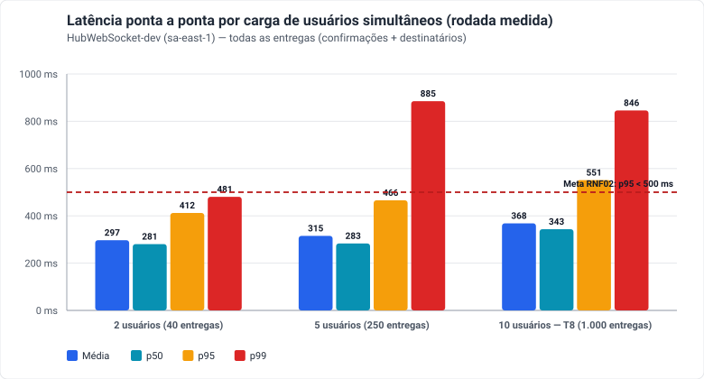
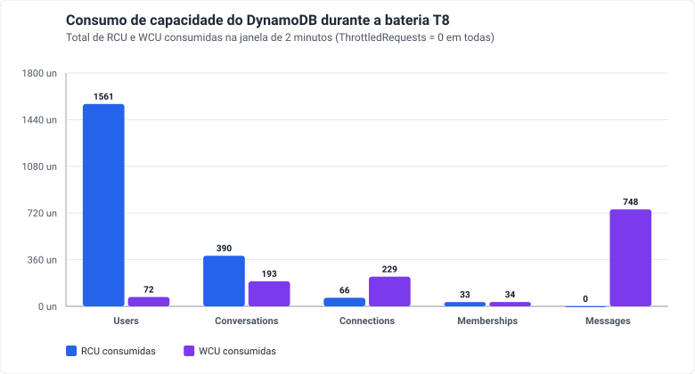
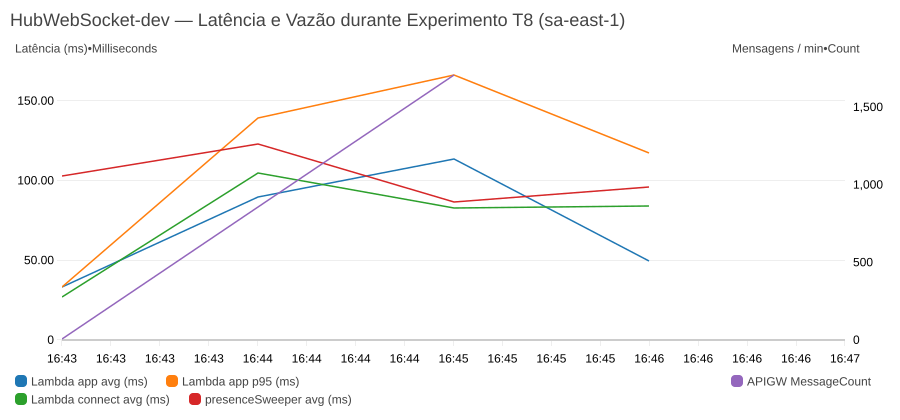

# Avaliação de desempenho (Experimento T8)

**Projeto:** Hub Colaborativo WebSocket  
**Ambiente medido:** `HubWebSocket-dev` na região `sa-east-1` (São Paulo, D07), API Gateway WebSocket (`throttle 1.000 rps / burst 2.000`) + Lambda (`Node.js 22.x`, anterior à atualização das Lambdas para o Node.js 24.x, **ARM64 Graviton2**, `512 MB` nas rotas e `256 MB` no `presenceSweeper` sem espera ociosa) + DynamoDB on-demand  
**Scripts e dados:** [scripts/load-test-t8.mjs](../scripts/load-test-t8.mjs), [docs/dados/t8-benchmark-10u.json](dados/t8-benchmark-10u.json), [docs/metricas-infraestrutura.md](metricas-infraestrutura.md)

## 1. Metodologia do experimento

Seguindo o plano de testes **T8** da [especificação](especificacao.md), o experimento executou múltiplos clientes WebSocket simultâneos na mesma máquina (evitando desvio de relógio entre emissor e receptor) dentro de um único grupo, de modo que cada mensagem dispara o fan-out para todos os membros (R06):

1. **Rodada de aquecimento (R05):** cada usuário envia 1 mensagem para aquecer os contêineres Lambda e o cache do segredo HMAC no SSM; os tempos são reportados à parte.
2. **Rodada medida:** todos os usuários enviam simultaneamente 10 mensagens em sequência, aguardando a confirmação da anterior antes de enviar a próxima (mesmo protocolo da fila do cliente web, RF12). Em caso de retry, a latência é medida a partir da tentativa inicial, e as entregas são deduplicadas por `(recipient, sender, messageId)`.
3. **Cargas avaliadas:** `2`, `5` e `10` usuários simultâneos no mesmo grupo (`40`, `250` e `1.000` entregas medidas, respectivamente).
4. **Verificação de ordem (RNF04):** ao final de cada bateria, compara-se a lista ordenada por `sk` de todas as mensagens recebidas por cada cliente.

## 2. Resultados da rodada medida (latência, vazão e ordem)

| Carga            | Mensagens | Entregas | Mín (ms) | Média (ms) | p50 (ms) |   p95 (ms) | p99 (ms) | Máx (ms) | Vazão (msgs/s) | Entregas/s | Retries | Ordem (RNF04)  |
| ---------------- | --------: | -------: | -------: | ---------: | -------: | ---------: | -------: | -------: | -------------: | ---------: | ------: | -------------- |
| 2 usuários       |        20 |       40 |   104,54 | **128,19** |   123,29 | **153,97** |   155,14 |   155,14 |          15,10 |      30,21 |       0 | 100% (22/22)   |
| 5 usuários       |        50 |      250 |   107,84 | **140,87** |   130,30 | **167,66** |   553,41 |   582,52 |          28,54 |     142,70 |       0 | 100% (55/55)   |
| 10 usuários (T8) |       100 |    1.000 |   100,56 | **160,67** |   131,71 | **166,05** |   598,07 | 2.337,24 |          27,82 |     278,16 |       1 | 100% (110/110) |

A distribuição de latência entre a confirmação ao remetente e a entrega aos demais participantes manteve-se simétrica em todas as cargas (em 10 usuários: confirmação média `159,80 ms` / p95 `164,66 ms` vs. entrega aos pares média `160,76 ms` / p95 `166,49 ms`, com `0` entregas duplicadas), confirmando o paralelismo efetivo da difusão.

## 3. Rodada de aquecimento (impacto de cold start — R05)

| Carga            | Mensagens | Entregas | Média aquecimento (ms) | p95 aquecimento (ms) | Média medida (ms) | Redução na média |
| ---------------- | --------: | -------: | ---------------------: | -------------------: | ----------------: | ---------------: |
| 2 usuários       |         2 |        4 |                 167,30 |               191,85 |            128,19 |           −23,4% |
| 5 usuários       |         5 |       25 |                 209,76 |               303,88 |            140,87 |           −32,8% |
| 10 usuários (T8) |        10 |      100 |                 488,86 |             1.002,33 |            160,67 |           −67,1% |

O descarte da rodada de aquecimento reduziu a latência média em **67,1%** no cenário de 10 usuários (`488,86 ms` → `160,67 ms`) e o p95 em **83,4%** (`1.002,33 ms` → `166,05 ms`), validando a mitigação definida em **R05**.

## 4. Consumo de infraestrutura e impacto das otimizações

Os dados completos do CloudWatch exportados durante a bateria ([docs/metricas-infraestrutura.md](metricas-infraestrutura.md)) mostram zero erros nas cinco funções Lambda (`Errors = 0`) e zero throttling nas cinco tabelas DynamoDB (`ThrottledRequests = 0`).

### Evolução antes vs. depois das otimizações de memória, arquitetura e `presenceSweeper` (10 usuários — T8)

Os números do baseline vêm de uma medição anterior, cujos dados brutos não estão em `docs/dados/`.

| Configuração          | Memória / Arquitetura (`app`) | `presenceSweeper`                | Média T8 (ms) | p95 T8 (ms) | Vazão (entregas/s) | RNF02 (`p95 < 500 ms`)       |
| --------------------- | ----------------------------- | -------------------------------- | ------------: | ----------: | -----------------: | ---------------------------- |
| Baseline inicial      | `128 MB` x86_64               | 2 varreduras, com espera de 30 s |        368,14 |      551,06 |             157,74 | Não atendido                 |
| **Otimizado (atual)** | **`512 MB` ARM64**            | **Passagem única (~105 ms)**     |    **160,67** |  **166,05** |         **278,16** | **Aprovado (−69,9% no p95)** |

### Avaliação frente aos requisitos (RNF02 e RNF04)

- **RNF02 (`p95 < 500 ms` com 10 usuários):** **aprovado com folga em todas as cargas** — `153,97 ms` (2u), `167,66 ms` (5u) e **`166,05 ms`** (10u, mais de 3× abaixo do limite de `500 ms`), mesmo contabilizando a latência integral de `1` mensagem retentada (`max = 2.337,24 ms`) por contenção pontual na cota inicial `ConcurrentExecutions = 10` da conta nova.
- **RNF04 (ordenação consistente):** **aprovado integralmente (`100%`)** em todas as cargas (`22/22`, `55/55` e `110/110` mensagens únicas na exata ordem de `sk`, sem perdas nem duplicatas).
- **Recomendação para produção (`prod`):** solicitar o desbloqueio da cota padrão `ConcurrentExecutions = 1.000` na conta AWS para eliminar inclusive o retry pontual na cauda `p99`/`máx` em rajadas acima de 10 usuários simultâneos.
