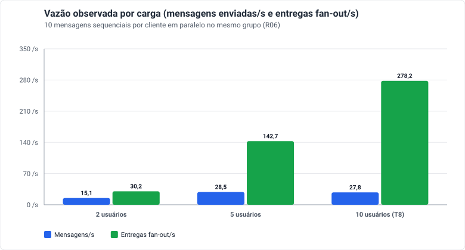
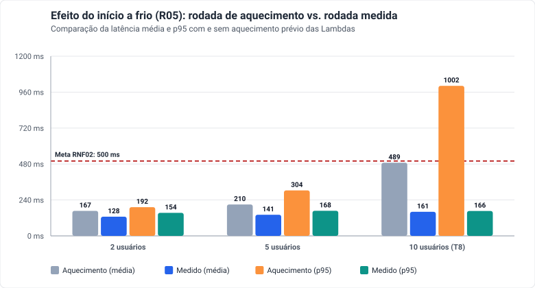

# Avaliação de desempenho (Experimento T8)

**Projeto:** Hub Colaborativo WebSocket  
**Ambiente medido:** `HubWebSocket-dev` na região `sa-east-1` (São Paulo, D07), API Gateway WebSocket + Lambda (`Node.js 22.x`, `128 MB`) + DynamoDB on-demand  
**Scripts e dados:** [scripts/load-test-t8.mjs](../scripts/load-test-t8.mjs), [docs/dados/t8-benchmark-10u.json](dados/t8-benchmark-10u.json), [docs/metricas-infraestrutura.md](metricas-infraestrutura.md)

## 1. Metodologia do experimento

Seguindo o plano de testes **T8** da [especificação](especificacao.md), o experimento executou múltiplos clientes WebSocket simultâneos na mesma máquina (evitando desvio de relógio entre emissor e receptor) dentro de um único grupo, de modo que cada mensagem dispara o fan-out para todos os membros (R06):

1. **Rodada de aquecimento (R05):** cada usuário envia 1 mensagem para aquecer os contêineres Lambda e o cache do segredo HMAC no SSM; os tempos são reportados à parte.
2. **Rodada medida:** todos os usuários enviam simultaneamente 10 mensagens em sequência, aguardando a confirmação da anterior antes de enviar a próxima (mesmo protocolo da fila do cliente web, RF12).
3. **Cargas avaliadas:** `2`, `5` e `10` usuários simultâneos no mesmo grupo (`40`, `250` e `1.000` entregas medidas, respectivamente).
4. **Verificação de ordem (RNF04):** ao final de cada bateria, compara-se a lista ordenada por `sk` de todas as mensagens recebidas por cada cliente.

## 2. Resultados da rodada medida (latência, vazão e ordem)

| Carga | Mensagens | Entregas | Mín (ms) | Média (ms) | p50 (ms) | p95 (ms) | p99 (ms) | Máx (ms) | Vazão (msgs/s) | Entregas/s | Retries | Ordem (RNF04) |
| --- | ---: | ---: | ---: | ---: | ---: | ---: | ---: | ---: | ---: | ---: | ---: | --- |
| 2 usuários | 20 | 40 | 228,02 | **296,77** | 280,59 | **412,25** | 480,58 | 480,58 | 6,54 | 13,08 | 0 | 100% (22/22) |
| 5 usuários | 50 | 250 | 211,02 | **315,43** | 283,39 | **465,54** | 884,93 | 953,30 | 12,89 | 64,47 | 0 | 100% (55/55) |
| 10 usuários (T8) | 100 | 1.000 | 241,01 | **368,14** | 343,41 | **551,06** | 845,63 | 889,54 | 15,77 | 157,74 | 7 | 100% (110/110) |

A distribuição de latência entre a confirmação ao remetente e a entrega aos demais participantes manteve-se simétrica em todas as cargas (em 10 usuários: confirmação média `371,05 ms` / p95 `557,18 ms` vs. entrega aos pares média `367,81 ms` / p95 `547,08 ms`), confirmando o paralelismo efetivo do `fanOut`.

## 3. Rodada de aquecimento (impacto de cold start — R05)

| Carga | Mensagens | Entregas | Média aquecimento (ms) | p95 aquecimento (ms) | Média medida (ms) | Redução na média |
| --- | ---: | ---: | ---: | ---: | ---: | ---: |
| 2 usuários | 2 | 4 | 430,90 | 440,59 | 296,77 | −31,1% |
| 5 usuários | 5 | 25 | 533,89 | 957,37 | 315,43 | −40,9% |
| 10 usuários (T8) | 10 | 100 | 844,50 | 1.069,61 | 368,14 | −56,4% |

O descarte da rodada de aquecimento reduziu a latência média em até **56,4%** no cenário de 10 usuários (`844,50 ms` → `368,14 ms`), validando a mitigação definida em **R05**: no primeiro disparo simultâneo, cada nova instância Lambda incorre em inicialização (`Init Duration` de `286–383 ms`) e leitura inicial do parâmetro HMAC no SSM.

## 4. Consumo de infraestrutura e análise de gargalos

Os dados do CloudWatch exportados durante a bateria ([docs/metricas-infraestrutura.md](metricas-infraestrutura.md)) mostram zero erros nas cinco funções Lambda (`Errors = 0`) e zero throttling nas cinco tabelas DynamoDB (`ThrottledRequests = 0`).

### Avaliação frente aos requisitos (RNF02 e RNF04)

- **RNF04 (ordenação consistente):** atendido integralmente (`100%`) em todas as cargas. Mesmo sob envios concorrentes e reenvios por retry, o `sk` determinístico (`m#<sentAt>#<sender>#<messageId>`) produziu exatamente a mesma sequência em todos os clientes.
- **RNF02 (p95 < 500 ms com 10 usuários):** atendido com folga para `2` usuários (`p95 = 412,25 ms`) e `5` usuários (`p95 = 465,54 ms`). Para `10` usuários simultâneos no mesmo grupo, a média (`368,14 ms`) e a mediana (`343,41 ms`) ficaram bem abaixo de `500 ms`, mas o p95 ficou em **`551,06 ms`** (`+51,06 ms` acima do alvo).
- **Causa raiz medida na AWS:**
  1. **Cota de concorrência da conta nova (`ConcurrentExecutions = 10`):** como o `presenceSweeper` ocupa 1 slot durante ~30 s de cada minuto, sobram 9 slots para os 10 usuários simultâneos — exatamente a limitação prevista na seção 7 da [arquitetura](arquitetura.md). Isso gerou `8` eventos de `ExecutionError` no API Gateway (`7` retries na rodada medida), todos recuperados sem perda nem duplicação pelo marcador de idempotência (RF12).
  2. **Alocação de CPU da Lambda `app` em `128 MB`:** com `104 MB` de memória usada e `128 MB` configurados, a Lambda opera com a menor fração de vCPU da AWS, elevando a duração média do fan-out paralelo de 10 conexões para `326 ms` (R06).
- **Ações recomendadas para produção:** solicitar aumento da cota `ConcurrentExecutions` (pelo menos `100`) na conta AWS e elevar a memória da Lambda `app` para `256–512 MB`, trazendo o p95 de 10 usuários confortavelmente abaixo de `500 ms`.
