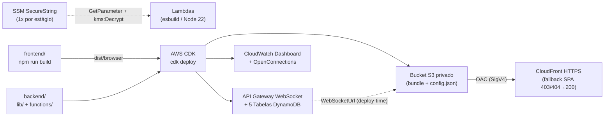

# Observabilidade e implantação

**Projeto:** Hub Colaborativo WebSocket

## 1. Introdução

Este documento detalha como o sistema expõe seu comportamento em produção (logs estruturados anonimizados, métricas e painel no CloudWatch) e como a infraestrutura e o cliente web são empacotados e implantados via AWS CDK. As decisões de arquitetura (D02, D05, D08) e o esquema de nomes e métricas estão na [arquitetura](arquitetura.md) (seção 5), e os requisitos (RNF03, RNF05, RNF06, RNF07), na [especificação](especificacao.md).

## 2. Logs estruturados e anonimização

Todas as rotas WebSocket (`connect`, `disconnect`, `default` e `app`) passam pelo invólucro `withRequestLog` (`backend/functions/shared.ts`), que garante exatamente uma linha JSON por requisição no CloudWatch Logs, inclusive quando uma exceção é lançada (RNF03). A duração (`durationMs`) é medida a partir de `requestTimeEpoch` (instante de chegada no API Gateway), permitindo comparar rotas de forma homogênea.

Os identificadores (`connectionId`, `username` e `conversationId`) nunca são registrados em claro: são substituídos pelos 12 primeiros caracteres hexadecimais de `HMAC-SHA256(segredo, valor)` usando um segredo único por estágio armazenado como `SecureString` no SSM Parameter Store (`/hub-websocket/<estágio>/log-hmac-secret`). Assim, os logs continuam correlacionáveis entre rotas sem expor usuários nem conversas, e o texto das mensagens nunca é gravado.

- **Cache e segurança em falha:** o segredo é lido uma vez por instância Lambda no cold start e reutilizado nas requisições seguintes. Se a leitura do SSM falhar, o cache é descartado para permitir nova tentativa na invocação seguinte e os identificadores são omitidos da linha de log (nunca vazam em claro).
- **Menor privilégio:** as Lambdas de rota recebem `ssm:GetParameter` apenas no ARN do parâmetro do estágio e `kms:Decrypt` restrito à chave gerenciada `alias/aws/ssm` via serviço `ssm.<região>.amazonaws.com`.
- **Resultados registrados:** `ok`, `duplicate` (reenvio idempotente de `sendMessage`, RF12), `gone` (resposta não entregue por `410 Gone`), `rejected` (recusa no `$connect` ou conexão não registrada) e `error` (erro de aplicação ou exceção, acompanhado de `code` e/ou `error`).

## 3. Métricas, painel e alarmes no CloudWatch

O stack CDK provisiona o painel `HubWebSocket-<estágio>` (RNF06) reunindo métricas do API Gateway WebSocket (`AWS/ApiGateway`), das cinco Lambdas (`AWS/Lambda`) e a métrica customizada `OpenConnections` (namespace `HubWebSocket/<estágio>`), publicada a cada minuto pelo `presenceSweeper` com o total de conexões ativas ao fim das varreduras — sem leituras extras no DynamoDB.

Os quatro gráficos do painel cobrem:

- **Conexões:** `ConnectCount` (soma/min) e `OpenConnections` (máximo/min).
- **Mensagens e requisições:** `MessageCount` do API Gateway junto com `Invocations` de `app`, `default`, `connect` e `disconnect`.
- **Erros:** `IntegrationError`, `ClientError` e `ExecutionError` do API Gateway e `Errors` de cada uma das cinco Lambdas.
- **Latência (ms):** `IntegrationLatency` (média e p95) e `Duration` da Lambda `app` (média e p95).

No lado do cliente web, o painel opcional **Telemetria e eventos** (`TelemetryDialog`) complementa a observabilidade exibindo eventos locais (reconexões, presença e reenvios da fila) e o Round-Trip Time (RTT) medido em `heartbeat`/`pong` e nas confirmações de `sendMessage`.

Para operação contínua em produção, recomenda-se associar alarmes do CloudWatch a: `ExecutionError > 0` ou `IntegrationError > 0` por 2 períodos consecutivos, `Errors > 0` na Lambda `app` ou `presenceSweeper`, `IntegrationLatency` p95 acima de `400 ms` (margem de segurança para o RNF02 de `500 ms`), e uso de `ConcurrentExecutions` próximo à cota da conta (seção 7 da arquitetura).

## 4. Empacotamento e implantação (IaC)

Toda a infraestrutura — API Gateway WebSocket, cinco tabelas DynamoDB on-demand, cinco funções Lambda empacotadas com esbuild (`NodejsFunction`), agendamento no EventBridge Scheduler, painel do CloudWatch e hospedagem do frontend (S3 privado + CloudFront com OAC, D08) — é versionada em um único stack CDK por estágio (`HubWebSocket-dev` e `HubWebSocket-prod`) na região `sa-east-1` (RNF05, D07).

- **Hospedagem do frontend (RNF07):** o bucket S3 bloqueia todo acesso público (`BLOCK_ALL`), exige TLS (`enforceSSL`) e usa criptografia gerenciada (`S3_MANAGED`). O CloudFront acessa o bucket exclusivamente por **Origin Access Control (OAC)**, redireciona HTTP para HTTPS e redireciona erros `403`/`404` para `/index.html` (HTTP 200) para suportar rotas da SPA Angular (`/entrar`, `/c/<id>`).
- **Configuração sem segredo no Git:** o `BucketDeployment` gera `config.json` em tempo de implantação com `{ "websocketUrl": "<saída WebSocketUrl>" }` e publica com comportamento de cache desabilitado (`CACHING_DISABLED`) no CloudFront, além de invalidar `/*` a cada deploy.
- **Separação entre estágios:** no `dev`, tabelas e bucket usam `RemovalPolicy.DESTROY` (com `autoDeleteObjects`) para facilitar testes; no `prod`, usam `RemovalPolicy.RETAIN` para evitar perda acidental de dados.
- **Ordem de implantação:** (1) `npx cdk bootstrap` uma vez por conta/região; (2) criar o parâmetro SSM `SecureString` do estágio; (3) compilar o frontend (`cd frontend && npm ci && npm run build`); (4) validar o backend (`npm run build && npm run lint && npm test && npx cdk synth`); (5) implantar com `npx cdk deploy HubWebSocket-<estágio>`.
