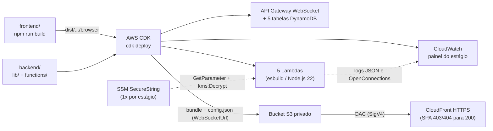

# Observabilidade e implantação

**Projeto:** Hub Colaborativo WebSocket

## 1. Introdução

Este documento detalha como o sistema expõe seu comportamento em produção (logs estruturados anonimizados, métricas e painel no CloudWatch) e como a infraestrutura e o cliente web são empacotados e implantados via AWS CDK. Ele ilustra a seção 5 e as decisões de arquitetura (D02, D05, D07, D08) da [arquitetura](arquitetura.md), que continua sendo a referência, e os requisitos (RNF03, RNF05, RNF06, RNF07), na [especificação](especificacao.md).

## 2. Logs estruturados e anonimização

Todas as rotas WebSocket (`connect`, `disconnect`, `default` e `app`) passam pelo invólucro `withRequestLog` (`backend/functions/shared.ts`), que garante exatamente uma linha JSON por requisição no CloudWatch Logs, inclusive quando uma exceção é lançada (RNF03), medindo `durationMs` a partir de `requestTimeEpoch`. Já o `presenceSweeper` (`backend/functions/presenceSweeper.ts`), acionado pelo EventBridge Scheduler, chama `log` diretamente com `route: 'presenceSweeper'` e `durationMs` contado do início da execução.

Conforme a seção 5 da [arquitetura](arquitetura.md), o texto das mensagens nunca é registrado e os identificadores (`connectionId`, `username` e `conversationId`) são substituídos pelos 12 primeiros caracteres hexadecimais de `HMAC-SHA256(segredo, valor)`, usando o parâmetro `SecureString` `/hub-websocket/<estágio>/log-hmac-secret` no SSM Parameter Store:

- **Cache e segurança em falha:** o segredo é lido na primeira requisição da instância Lambda e mantido em cache. Se a leitura do SSM falhar, a promessa em cache é descartada para permitir nova tentativa na invocação seguinte e os identificadores são omitidos da linha de log (nunca vazam em claro).
- **Menor privilégio:** apenas as quatro Lambdas de rota recebem `ssm:GetParameter` no ARN do parâmetro do estágio e `kms:Decrypt` restrito a `alias/aws/ssm` via `ssm.<região>.amazonaws.com`; o `presenceSweeper` não lê esse parâmetro porque não registra identificadores.
- **Resultados registrados (`result`):** `ok`, `duplicate` (reenvio idempotente de `sendMessage`, RF12), `gone` (resposta não entregue por `410 Gone`), `rejected` (recusa no `$connect` ou `sendMessage` em conexão sem registro) e `error` (erro de aplicação ou exceção, com `code` e/ou `error`; uma falha apenas no anúncio de presença do `$connect` registra `result: 'ok'` com `error` sem derrubar o handshake).

## 3. Métricas, painel e alarmes no CloudWatch

O stack CDK provisiona o painel `HubWebSocket-<estágio>` (RNF06) reunindo métricas do API Gateway WebSocket (`AWS/ApiGateway`), das Lambdas (`AWS/Lambda`) e a métrica customizada `OpenConnections` (namespace `HubWebSocket/<estágio>`), publicada a cada minuto pelo `presenceSweeper` com o total de conexões ativas ao fim das varreduras — sem leituras extras no DynamoDB.

Os quatro gráficos do painel cobrem, em janelas de 1 minuto:

- **Conexões:** `ConnectCount` (soma) e `OpenConnections` (máximo).
- **Mensagens e requisições:** `MessageCount` do API Gateway junto com `Invocations` de `app`, `default`, `connect` e `disconnect`.
- **Erros:** `IntegrationError`, `ClientError` e `ExecutionError` do API Gateway e `Errors` de cada uma das cinco Lambdas (`connect`, `disconnect`, `default`, `app` e `presenceSweeper`).
- **Latência (ms):** `IntegrationLatency` (média e p95) e `Duration` da Lambda `app` (média e p95).

No cliente web, os logs operacionais usados nos testes (anúncios de presença e reenvios da fila) são registrados no console do navegador (seção 4.6 da [arquitetura](arquitetura.md)).

Para operação contínua em produção, recomenda-se associar alarmes do CloudWatch a: `ExecutionError > 0` ou `IntegrationError > 0` por 2 períodos consecutivos, `Errors > 0` nas Lambdas (em especial `app` e `presenceSweeper`), `IntegrationLatency` p95 acima de `400 ms` (margem de segurança para o RNF02 de `500 ms`), e uso de `ConcurrentExecutions` próximo à cota da conta (seção 7 da [arquitetura](arquitetura.md)).

## 4. Empacotamento e implantação (IaC)

Toda a infraestrutura — API Gateway WebSocket, cinco tabelas DynamoDB on-demand, cinco funções Lambda empacotadas com esbuild (`NodejsFunction`), agendamento no EventBridge Scheduler, painel do CloudWatch e hospedagem do frontend (S3 privado + CloudFront com OAC, D08) — é versionada em um único stack CDK por estágio (`HubWebSocket-dev` e `HubWebSocket-prod`) na região `sa-east-1` (RNF05, D07).

- **Hospedagem do frontend (RNF07):** o bucket S3 bloqueia todo acesso público (`BLOCK_ALL`), exige TLS (`enforceSSL`) e usa criptografia gerenciada (`S3_MANAGED`). O CloudFront acessa o bucket exclusivamente por **Origin Access Control (OAC)**, redireciona HTTP para HTTPS e mapeia erros `403`/`404` para `/index.html` (HTTP 200) para suportar rotas da SPA Angular (`/entrar`, `/c/<id>`).
- **Configuração sem segredo no Git:** o `BucketDeployment` gera `config.json` em tempo de implantação com `{ "websocketUrl": "<saída WebSocketUrl>" }` e invalida `/*` na distribuição, que define cache desabilitado (`CACHING_DISABLED`) para `config.json`.
- **Separação entre estágios:** no `dev`, tabelas e bucket usam `RemovalPolicy.DESTROY` (com `autoDeleteObjects` no bucket) para facilitar testes; no `prod`, usam `RemovalPolicy.RETAIN` para evitar perda acidental de dados.
- **Ordem de implantação:** (1) `npx cdk bootstrap` uma vez por conta/região; (2) criar o parâmetro SSM `SecureString` do estágio; (3) compilar o frontend (`cd frontend && npm ci && npm run build`); (4) validar o backend (`cd backend && npm run build && npm run lint && npm test && npx cdk synth HubWebSocket-<estágio>`); (5) implantar com `npx cdk deploy HubWebSocket-<estágio>`. Os comandos completos estão no [README do backend](../backend/README.md).
