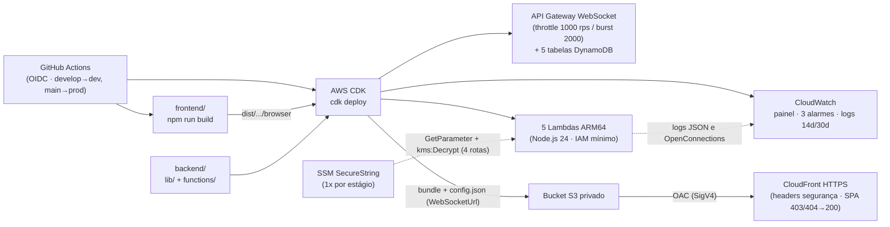

# Observabilidade e implantação

**Projeto:** Hub Colaborativo WebSocket

## 1. Introdução

Este documento detalha como o sistema expõe seu comportamento em produção (logs estruturados anonimizados, métricas e painel no CloudWatch) e como a infraestrutura e o cliente web são empacotados e implantados via AWS CDK. Ele ilustra a seção 5 e as decisões de arquitetura (D02, D05, D07, D08) da [arquitetura](arquitetura.md), que continua sendo a referência, e os requisitos (RNF03, RNF05, RNF06, RNF07), na [especificação](especificacao.md).

## 2. Logs estruturados e anonimização

Todas as Lambdas de rota (`connect`, `disconnect`, `default` e `app`) passam pelo mesmo invólucro, que garante exatamente uma linha JSON por requisição no CloudWatch Logs, inclusive quando uma exceção é lançada (RNF03), medindo `durationMs` a partir de `requestTimeEpoch`. Já o `presenceSweeper`, acionado pelo EventBridge Scheduler, grava a própria linha com `route: 'presenceSweeper'` e `durationMs` contado do início da execução.

Conforme a seção 5 da [arquitetura](arquitetura.md), o texto das mensagens nunca é registrado e os identificadores (`connectionId`, `username` e `conversationId`) são substituídos pelos 12 primeiros caracteres hexadecimais de `HMAC-SHA256(segredo, valor)`, usando o parâmetro `SecureString` `/hub-websocket/<estágio>/log-hmac-secret` no SSM Parameter Store:

- **Cache, pré-carregamento e segurança em falha:** o segredo é pré-carregado em paralelo no início a frio (aguardado apenas ao registrar o log, sem bloquear a lógica de negócio) e mantido em cache. A leitura do SSM tem limite de 1 s. Se ela falhar, um aviso é emitido no console, os identificadores são omitidos da linha de log (nunca vazam em claro) e a leitura só é tentada de novo depois de 60 s.
- **Menor privilégio e retenção de logs:** apenas as quatro Lambdas de rota recebem `ssm:GetParameter` no ARN do parâmetro do estágio e `kms:Decrypt` restrito a `alias/aws/ssm` via `ssm.<região>.amazonaws.com`; o `presenceSweeper` não lê esse parâmetro porque não registra identificadores. Cada Lambda grava em um `LogGroup` gerenciado pelo CDK (`<função>Logs`) com retenção de **14 dias** em `dev` e **30 dias** em `prod`.
- **Resultados registrados (`result`):** `ok`, `duplicate` (reenvio idempotente de `sendMessage`, RF12), `gone` (resposta não entregue por `410 Gone`), `rejected` (recusa no `$connect` ou `sendMessage` em conexão sem registro) e `error` (erro de aplicação ou exceção, com `code` e/ou `error`; uma falha apenas no anúncio de presença do `$connect` registra `result: 'ok'` com `error` sem derrubar o handshake).

## 3. Métricas, painel e alarmes no CloudWatch

O stack CDK provisiona o painel `HubWebSocket-<estágio>` (RNF06) reunindo métricas do API Gateway WebSocket (`AWS/ApiGateway`), das Lambdas (`AWS/Lambda`), das cinco tabelas DynamoDB (`AWS/DynamoDB`) e a métrica customizada `OpenConnections` (namespace `HubWebSocket/<estágio>`), publicada a cada minuto pelo `presenceSweeper` com o total de conexões ativas ao fim da varredura — sem leituras extras no DynamoDB.

Os seis gráficos do painel cobrem, em janelas de 1 minuto:

- **Conexões:** `ConnectCount` (soma) e `OpenConnections` (máximo).
- **Mensagens e requisições:** `MessageCount` do API Gateway junto com `Invocations` de `app`, `default`, `connect` e `disconnect`.
- **Erros:** `IntegrationError`, `ClientError` e `ExecutionError` do API Gateway e `Errors` de cada uma das cinco Lambdas (`connect`, `disconnect`, `default`, `app` e `presenceSweeper`).
- **Latência (ms):** `IntegrationLatency` (média e p95), `Duration` das Lambdas `app` e `connect` (média e p95) e do `presenceSweeper` (média e máximo).
- **Throttles (Lambda):** `Throttles` das cinco funções Lambda.
- **DynamoDB (erros e throttling):** `SystemErrors` e `ThrottledRequests` de cada uma das cinco tabelas, somando as operações.

No cliente web, os logs operacionais usados nos testes — **tentativas de reconexão**, anúncios de presença recebidos e reenvios da fila — são registrados no console do navegador (seção 4.6 da [arquitetura](arquitetura.md)), complementados pelo painel opcional **Telemetria e eventos** e pelo indicador de RTT na barra superior.

O stack provisiona três alarmes no CloudWatch por estágio (`treatMissingData: NOT_BREACHING`): `HubWebSocket-<estágio>-AppErrors` (`Errors >= 1` na Lambda `app`), `HubWebSocket-<estágio>-AppThrottles` (`Throttles >= 1` na Lambda `app`) e `HubWebSocket-<estágio>-PresenceSweeperDuration` (`Duration` máxima `>= 20.000 ms`, com margem frente ao timeout de `30 s`). Para operação contínua em produção, recomenda-se associar ações SNS a esses alarmes e monitorar `IntegrationLatency` p95 acima de `400 ms` e `ConcurrentExecutions` próximo à cota da conta (seção 7 da [arquitetura](arquitetura.md)).

## 4. Empacotamento e implantação (IaC)

Toda a infraestrutura — API Gateway WebSocket (com throttling padrão de `1.000 req/s` e burst `2.000`), cinco tabelas DynamoDB on-demand, cinco funções Lambda em **ARM64 (Graviton2)** empacotadas com esbuild (`NodejsFunction`, `512 MB` / `10 s` nas quatro rotas e `256 MB` / `30 s` no `presenceSweeper`), agendamento no EventBridge Scheduler, painel e alarmes no CloudWatch e hospedagem do frontend (S3 privado + CloudFront com OAC, D08) — é versionada em um único stack CDK por estágio (`HubWebSocket-dev` e `HubWebSocket-prod`) na região `sa-east-1` (RNF05, D07).

- **Permissões IAM de menor privilégio:** apenas a Lambda `app` recebe leitura e escrita nas cinco tabelas; `connect`, `disconnect`, `default` e `presenceSweeper` recebem leitura/escrita em `Connections` e `Users` e somente leitura em `Memberships` e `Conversations`, sem nenhum acesso à tabela `Messages`.
- **Hospedagem do frontend e cabeçalhos de segurança (RNF07):** o bucket S3 bloqueia todo acesso público (`BLOCK_ALL`), exige TLS (`enforceSSL`) e usa criptografia gerenciada (`S3_MANAGED`). O CloudFront acessa o bucket exclusivamente por **Origin Access Control (OAC)**, redireciona HTTP para HTTPS, mapeia erros `403`/`404` para `/index.html` (HTTP 200) para rotas da SPA Angular (`/entrar`, `/c/<id>`) e aplica `ResponseHeadersPolicy` com `Strict-Transport-Security` (365 dias, subdomínios), `Content-Security-Policy`, `X-Content-Type-Options: nosniff`, `X-Frame-Options: DENY` e `Referrer-Policy: strict-origin-when-cross-origin`.
- **Configuração sem segredo no Git e cache:** o `BucketDeployment` gera `config.json` em tempo de implantação com `{ "websocketUrl": "<saída WebSocketUrl>" }` e invalida `/*` na distribuição, que desabilita o cache (`CACHING_DISABLED`) nos caminhos `/config.json` e `/index.html` e usa `CACHING_OPTIMIZED` no restante, inclusive nos bundles com hash. A documentação da AWS não diz se a raiz `/` segue o caminho de `index.html` ou o comportamento padrão; a invalidação de `/*` a cada implantação renova os dois.
- **Separação entre estágios e higiene de dados:** no `dev`, tabelas, `LogGroup`s e bucket usam `RemovalPolicy.DESTROY` (com `autoDeleteObjects` no bucket) e retenção de logs de `14 dias`; no `prod`, usam `RemovalPolicy.RETAIN`, retenção de `30 dias`, **Point-in-Time Recovery (PITR)** nas cinco tabelas DynamoDB e **versionamento** no bucket S3. A tabela `Messages` define `expiresAt` como atributo TTL gravado (7 dias) apenas nos marcadores de idempotência `id#…`, preservando indefinidamente as mensagens `m#…`.
- **Implantação contínua:** a GitHub Actions implanta o `HubWebSocket-dev` a cada push na `develop` e o `HubWebSocket-prod` a cada push na `main`, só depois que a CI valida backend e frontend, e o `prod` aguarda aprovação manual no environment `prod` do GitHub. O job reaproveita o build do frontend da CI e entra na AWS por OIDC, sem chaves de acesso guardadas no GitHub: assume o papel do stack `HubWebSocket-GitHubOidc`, aceito apenas para os environments `dev` e `prod` do repositório e limitado a assumir os papéis do `cdk bootstrap`. O papel de execução do CloudFormation e todos os papéis que os stacks criam carregam o permissions boundary `HubWebSocket-DeployBoundary`, do mesmo stack, que só permite os serviços usados pelo projeto e proíbe alterar o caminho de deploy (papéis do bootstrap, papel OIDC, bucket de staging e o próprio boundary) e criar usuários, chaves de acesso ou provedores de identidade.
- **Configuração inicial e deploy manual:** (1) `npx cdk bootstrap` uma vez por conta/região; (2) criar o parâmetro SSM `SecureString` de cada estágio; (3) implantar o `HubWebSocket-GitHubOidc`, com as credenciais de quem o implanta; (4) refazer o bootstrap com `--custom-permissions-boundary HubWebSocket-DeployBoundary`; (5) criar os environments no GitHub. O deploy manual continua possível: compilar o frontend (`cd frontend && npm ci && npm run build`) e rodar `npx cdk deploy HubWebSocket-<estágio>`. Os comandos completos estão no [README do backend](../backend/README.md).
