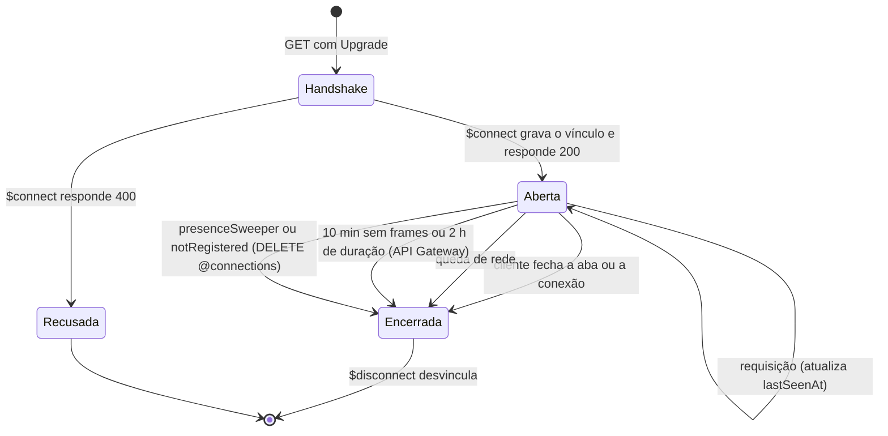
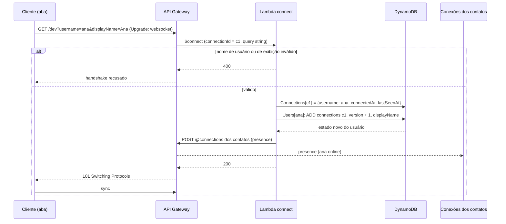
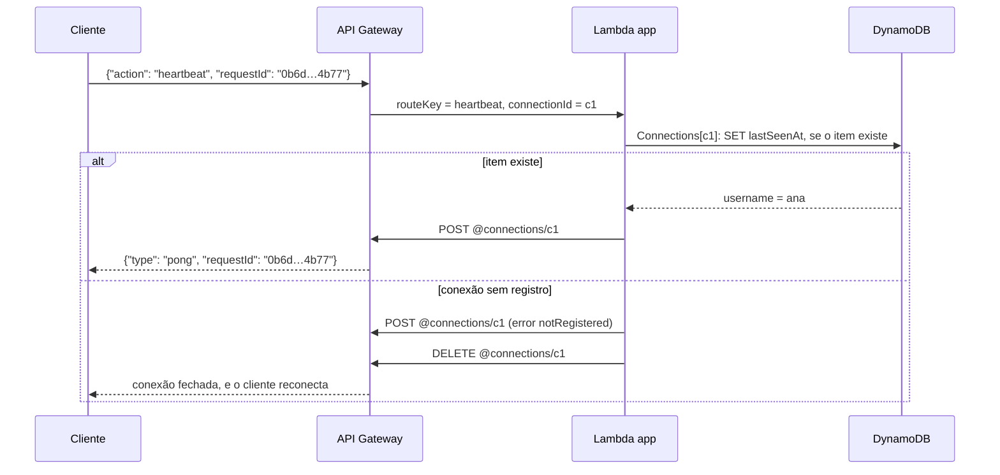
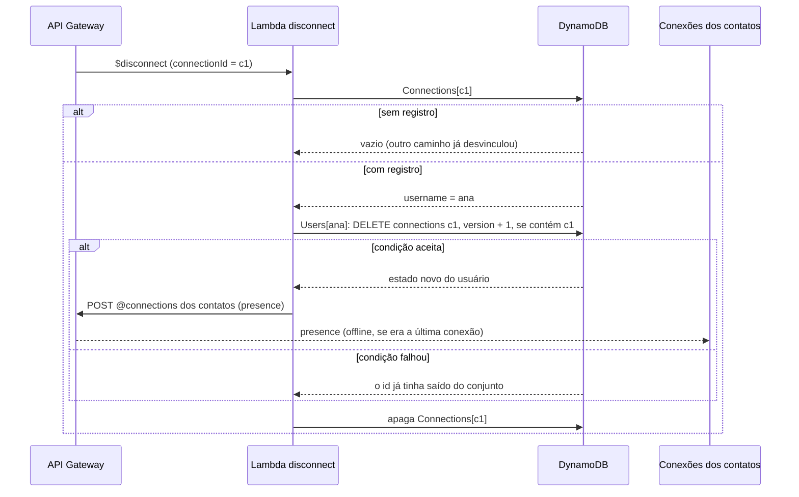

# Ciclo de vida da sessão

**Projeto:** Hub Colaborativo WebSocket

## 1. Introdução

Este documento descreve a sessão persistente entre o cliente web e a API WebSocket: como o handshake transforma uma requisição HTTP em uma conexão WebSocket, como os dados trafegam em frames, em que as mensagens WebSocket diferem do request/response HTTP e o que acontece do `$connect` ao `$disconnect`. Os nomes, as tabelas e os procedimentos citados estão na [arquitetura](arquitetura.md), e os requisitos (RF, RNF, R e L), na [especificação](especificacao.md).

Aqui, *sessão* é o período em que uma conexão WebSocket está aberta. Cada aba do navegador abre a própria conexão, então um usuário pode ter várias sessões ao mesmo tempo.

## 2. Handshake: de HTTP para WebSocket

Uma conexão WebSocket começa como uma requisição HTTP comum, que pede ao servidor a troca de protocolo (RFC 6455). O cliente informa o nome de usuário e o nome de exibição na query string, porque o `$connect` é o único momento em que o backend recebe dados antes de a conexão existir (RF01).

```http
GET /dev?username=ana&displayName=Ana HTTP/1.1
Host: {api-id}.execute-api.sa-east-1.amazonaws.com
Upgrade: websocket
Connection: Upgrade
Sec-WebSocket-Key: dGhlIHNhbXBsZSBub25jZQ==
Sec-WebSocket-Version: 13
```

O API Gateway chama a Lambda `connect` antes de responder. Se ela aceita, o handshake termina com:

```http
HTTP/1.1 101 Switching Protocols
Upgrade: websocket
Connection: Upgrade
Sec-WebSocket-Accept: s3pPLMBiTxaQ9kYGzzhZRbK+xOo=
```

O `Sec-WebSocket-Accept` é o SHA-1 da chave do cliente concatenada a um identificador fixo do protocolo, em Base64. Ele prova que o servidor entendeu o pedido de WebSocket e não é um servidor HTTP qualquer devolvendo uma resposta guardada em cache. Se a Lambda responde `400`, o API Gateway recusa o handshake, e a conexão nunca chega a existir (RF01, T1).

Depois do `101`, a mesma conexão TCP, cifrada por TLS (`wss://`), deixa de carregar HTTP e passa a carregar frames WebSocket nos dois sentidos.

## 3. Frames

Toda mensagem WebSocket viaja em um ou mais frames. Cada frame tem um cabeçalho curto com:

- **FIN:** indica o último frame de uma mensagem; uma mensagem grande pode ser dividida em vários frames.
- **opcode:** o tipo do frame: texto (`0x1`), binário (`0x2`), continuação (`0x0`) ou de controle: fechamento (`0x8`), ping (`0x9`) e pong (`0xA`).
- **máscara:** os frames do cliente para o servidor são sempre mascarados com uma chave aleatória, para que intermediários HTTP não interpretem o conteúdo como requisições.
- **tamanho:** 7 bits, estendidos para 16 ou 64 bits conforme o tamanho do conteúdo.

O projeto usa só frames de texto com JSON. O API Gateway impõe limites próprios: 32 KB por frame e 128 KB por mensagem, e acima disso fecha a conexão (L03). Por isso o cliente limita o tamanho das mensagens (RF11) e o histórico é enviado em páginas (seção 4.4 da arquitetura).

Os frames de ping e pong existem no protocolo, mas a API WebSocket do navegador não permite enviá-los nem observá-los. Por isso o heartbeat é uma requisição de aplicação (`heartbeat` → `pong`), que além de manter a conexão ativa passa pela Lambda e atualiza o `lastSeenAt` usado na expiração por inatividade (RF07, RF08).

## 4. Request/response HTTP e mensagens WebSocket

No HTTP, cada requisição recebe exatamente uma resposta, e o servidor só fala quando o cliente pergunta. No WebSocket, os dois lados enviam mensagens independentes a qualquer momento, e o protocolo não associa uma mensagem a outra.

| | HTTP | WebSocket no projeto |
| --- | --- | --- |
| Conexão | uma por requisição, ou reaproveitada, mas sem estado entre requisições | persistente, até 2 horas (L02) |
| Quem inicia | sempre o cliente | os dois lados |
| Resposta | implícita, uma por requisição | não existe no protocolo; o backend envia um evento com o mesmo `requestId` (RF09) |
| Identidade | enviada em cada requisição | definida no `$connect` e resolvida pelo `connectionId` em cada requisição (RNF01) |
| Envio do servidor ao cliente | impossível sem uma requisição | `postToConnection` a qualquer momento (RF02) |

Duas consequências aparecem no projeto. Primeiro, como não há resposta implícita, o cliente gera um `requestId` e o backend o devolve no evento `response`, `pong` ou `error`, e o cliente associa os dois. Segundo, a Lambda que atende uma rota não responde pela integração: tudo o que o cliente recebe chega por `@connections` (D06), o único caminho que também alcança os demais clientes.

## 5. Estados de uma conexão



Uma conexão encerrada nem sempre gera o `$disconnect`, porque a AWS o entrega em regime de melhor esforço (R01). O registro que sobra é removido pelo `410 Gone` no próximo envio a essa conexão (RF08) ou pelo `presenceSweeper` depois de 10 minutos sem requisições (RF07). Do lado do cliente, qualquer encerramento que ele não pediu leva à reconexão com backoff exponencial, que abre uma sessão nova com outro `connectionId` (RF08).

## 6. `$connect`



O vínculo grava `Connections` antes de incluir o id em `Users.connections`, então todo id do conjunto tem um registro (D09). O `$connect` não envia nada à própria conexão, porque o API Gateway só aceita `postToConnection` para ela depois do `101`; por isso o cliente pede o próprio estado com `sync` logo depois de abrir a conexão (seção 3.4 da arquitetura).

## 7. Requisições durante a sessão

Cada requisição chega à Lambda com o `connectionId`, que o API Gateway informa e o cliente não consegue alterar. A Lambda resolve o usuário a partir dele e nunca a partir do corpo da requisição (seção 3.2 da arquitetura).



No sentido contrário, para entregar um evento a um usuário, o backend resolve `username → Users.connections → connectionIds` e faz um `postToConnection` para cada um. Uma resposta `410 Gone` indica, em geral, que a conexão já caiu sem `$disconnect`: o backend a desvincula e continua com as demais (RF08). A exceção são os primeiros 30 s após o `$connect`, em que o `410` vem do handshake ainda em andamento, e a conexão não é desvinculada (seção 3.4 da arquitetura).

## 8. `$disconnect`



O `$disconnect` acontece depois que a conexão já fechou, então não há como enviar nada a ela. O mesmo procedimento de desvínculo é usado pelo `410 Gone` e pelo `presenceSweeper`, e a condição `contains(connections, :id)` faz com que cada id seja removido uma única vez, mesmo com os três caminhos em paralelo (seção 3.4 da arquitetura).

## 9. Diretório de clientes

O diretório é formado pelas tabelas `Connections` e `Users` (seção 3.3 da arquitetura), que juntas resolvem os nomes nos dois sentidos. Com `ana` em duas abas e `bia` em uma, ele fica assim:

**Connections**

| `connectionId` | `username` | `connectedAt` | `lastSeenAt` |
| --- | --- | --- | --- |
| `c1` | `ana` | 10:00:00 | 10:04:30 |
| `c2` | `ana` | 10:02:10 | 10:04:40 |
| `c3` | `bia` | 10:01:05 | 10:04:20 |

**Users**

| `username` | `displayName` | `connections` | `version` |
| --- | --- | --- | --- |
| `ana` | Ana | `{c1, c2}` | 2 |
| `bia` | Bia | `{c3}` | 1 |

Quando `c1` fecha, o id sai do conjunto de `ana` e depois o item `c1` sai de `Connections`, que continua online pela `c2` (RF07). Quando `c3` fecha, o atributo `connections` de `bia` desaparece, e os contatos dela recebem o anúncio de offline.
