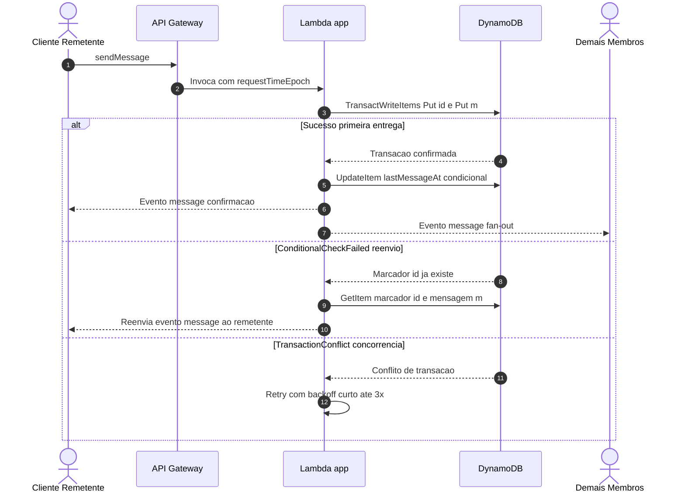

# Sincronização, Consistência e Ciclo de Vida das Conversas

**Projeto:** Hub Colaborativo WebSocket

## 1. Introdução

Este documento especifica os mecanismos distribuídos que garantem a ordenação global de mensagens, a idempotência contra reenvios, o modelo de consistência de leitura e escrita no DynamoDB e o ciclo de vida das conversas privadas, grupos e histórico paginado. Os requisitos citados (`RF`, `RNF`, `R`, `L` e `T`) estão definidos na [especificação](especificacao.md), e o esquema de tabelas, rotas e decisões arquiteturais (`D01`–`D11`) está detalhado na [arquitetura](arquitetura.md).

---

## 2. Sincronização Temporal e Ordenação Global de Mensagens

### 2.1 Autoridade Temporal do Servidor (`RF02`, `RNF04`)

Em sistemas distribuídos baseados em navegadores web, os relógios locais dos clientes (`Date.now()`) sofrem desvios arbitrários (*clock skew*) decorrentes de configurações manuais do sistema operacional, fusos horários incorretos ou falta de sincronização NTP. Confiar no timestamp gerado pelo cliente permitiria que mensagens enviadas posteriormente aparecessem antes de mensagens anteriores ou fossem inseridas no passado da linha do tempo.

Para eliminar essa dependência, o sistema adota a **autoridade temporal centralizada no servidor**:

* **Carimbo de tempo oficial (`sentAt`):** Atribuído exclusivamente pelo backend utilizando `requestContext.requestTimeEpoch` (em milissegundos), registrado pelo Amazon API Gateway no instante em que o frame da requisição chega à borda da infraestrutura.
* **Imutabilidade temporal:** O cliente nunca envia ou altera o campo `sentAt`. O timestamp retornado pelo servidor no evento `message` torna-se o valor definitivo para todos os participantes e abas conectadas.

### 2.2 Chave de Ordenação Determinística (`sk`)

Na tabela `Messages`, cada mensagem persistida recebe uma *Sort Key* (`sk`) composta e determinística no formato:

    m#<sentAt com 13 dígitos preenchidos com zero à esquerda>#<sender>#<messageId>

**Exemplo:** `m#1731542400123#wallyson#550e8400-e29b-41d4-a716-446655440000`

Essa estrutura estabelece uma **ordem total estrita** entre todas as mensagens de uma mesma conversa (`PK = conversationId`), utilizando três níveis de desempate lexicográfico:

1. **`sentAt` (13 dígitos):** Garante ordenação cronológica exata pela chegada ao API Gateway (o preenchimento com zeros à esquerda preserva a ordem lexicográfica em strings).
2. **`sender`:** Caso dois usuários distintos enviem mensagens que cheguem exatamente no mesmo milissegundo (`sentAt` idêntico), o nome de usuário normalizado desempata a posição de forma determinística.
3. **`messageId` (UUID v4):** Caso o mesmo usuário dispare duas mensagens distintas no mesmo milissegundo, o identificador único gerado pelo cliente elimina qualquer ambiguidade residual.

**Convergência no Cliente (`RNF04`):** Devido a variações de latência de rede ou *fan-out* paralelo entre múltiplas conexões, diferentes clientes podem receber os eventos `message` fora da ordem cronológica. Ao receber qualquer evento `message`, o cliente insere o item na lista local ordenando estritamente pela chave `sk` e descartando duplicatas pelo mesmo `sk`. Dessa forma, sem necessidade de coordenação entre clientes, todas as abas e participantes convergem para a mesma sequência de mensagens.

### 2.3 Janela de Sobreposição na Reconexão (`sync` e `getHistory`)

Em um ambiente *serverless* (AWS Lambda), uma requisição recebida pelo API Gateway no instante $t_1$ pode sofrer atraso de inicialização (*cold start*) ou contenção de CPU até o limite de execução de 10 segundos da Lambda `app`, sendo gravada no DynamoDB alguns milissegundos ou segundos após outra requisição recebida em $t_2 > t_1$.

Se um cliente reconectado solicitasse apenas mensagens posteriores ao instante exato da sua última mensagem conhecida ($t_{\text{último}}$), uma mensagem recebida antes da queda ($t_1 < t_{\text{último}}$), mas persistida depois, poderia ser omitida. Para mitigar esse cenário (`RF08`):

* O cliente aplica um **recuo de segurança de 30 segundos** ao informar o parâmetro `since` na ação `sync` (e `after` no `getHistory` de conversas já abertas).
* As mensagens já conhecidas dentro dessa janela de sobreposição são deduplicadas localmente pelo `sk`, enquanto eventuais mensagens gravadas com atraso são incorporadas na posição cronológica correta.

---

## 3. Deduplicação e Idempotência (`RF12`, `R07`)

### 3.1 Separação entre Marcador de Idempotência e Registro de Mensagem

Redes móveis e conexões WebSocket estão sujeitas a quedas silenciosas entre o envio do frame pelo cliente e o recebimento da confirmação pelo servidor. Se o cliente reenviar uma mensagem cuja primeira tentativa já foi persistida, o sistema deve impedir a duplicação no histórico sem retornar erro ao usuário.

Para isso, a tabela `Messages` armazena dois tipos de itens na mesma partição (`PK = conversationId`):

| Tipo de Item | Sort Key (`SK`) | Atributos Principais | Finalidade |
| :--- | :--- | :--- | :--- |
| **Mensagem** | `m#<sentAt>#<sender>#<messageId>` | `messageId`, `sender`, `text`, `sentAt` | Registro imutável exibido no histórico da conversa. |
| **Marcador de Duplicata** | `id#<sender>#<messageId>` | `ref` (aponta para o `sk` da mensagem original) | Garante unicidade por `(conversationId, sender, messageId)` antes que o `sentAt` seja conhecido. |

O prefixo `id#` inclui explicitamente `<sender>` para garantir que dois usuários distintos que eventualmente gerem o mesmo UUID (`messageId`) não colidam entre si (`T7`).

### 3.2 Fluxo Transacional de Escrita e Tratamento de Reenvios

A gravação da mensagem e do seu marcador ocorre em uma única operação atômica (`TransactWriteItems`) com condição de inexistência (`attribute_not_exists(sk)`) em ambos os itens:

**Controle de Fila no Cliente:** Quando offline ou aguardando confirmação, o cliente enfileira as mensagens localmente e as reenvia **uma por vez** (a cada 15 segundos após reconectar). O envio sequencial evita que duas mensagens pendentes cheguem ao API Gateway no mesmo milissegundo durante uma rajada de reconexão e tenham sua ordem relativa alterada pelo desempate do `messageId`.

---

## 4. Modelo de Consistência no DynamoDB

### 4.1 Leituras Fortemente Consistentes e Ausência de GSIs (`D04`)

Em sistemas de tempo real, uma leitura eventualmente consistente pode retornar dados obsoletos logo após uma escrita — por exemplo, ignorar uma conexão recém-registrada em `Users.connections` durante um *fan-out* ou omitir um membro recém-adicionado a um grupo.

Por esse motivo, o projeto adota duas diretrizes rigorosas:

1. **Consistência forte em todas as leituras:** Toda chamada `GetItem`, `BatchGetItem` e `Query` nas tabelas `Connections`, `Users`, `Conversations`, `Memberships` e `Messages` é executada com `ConsistentRead: true`.
2. **Proibição de Índices Secundários Globais (GSIs — `D04`):** O DynamoDB não suporta `ConsistentRead: true` em GSIs. Em vez de criar índices secundários, o modelo utiliza tabelas de projeção explícita mantidas por transações (`Memberships` indexada por `username` e `Conversations` indexada por `conversationId`), garantindo leitura fortemente consistente em todos os caminhos de acesso.

### 4.2 Transações Atômicas vs. Atualizações Condicionais

| Operação / Rota | Mecanismo no DynamoDB | Tabelas Envolvidas | Justificativa de Consistência |
| :--- | :--- | :--- | :--- |
| `sendMessage` (persistência) | `TransactWriteItems` (`Put` + `Put`) | `Messages` | Garante que nunca exista uma mensagem sem marcador de deduplicação, nem marcador órfão sem mensagem. |
| `sendMessage` (`lastMessageAt`) | `UpdateItem` condicional (`lastMessageAt < :sentAt`) | `Conversations` | Mantido **fora** da transação principal (`R06`, `T8`) para evitar contenção (`TransactionConflict`) no item da conversa sob alta concorrência de envios. |
| `openDirect` e `createGroup` | `TransactWriteItems` (`Put` conversa + `Put` membros) | `Conversations`, `Memberships` | Impede criação parcial de sala sem que todos os membros enxerguem a conversa imediatamente no `sync`. |
| `addMember` e `leaveGroup` | `TransactWriteItems` (`Update` lista + `Put`/`Delete` vínculo) | `Conversations`, `Memberships` | Mantém a lista `Conversations.members` e os registros individuais em `Memberships` estritamente sincronizados. |
| `$connect` e `$disconnect` | `UpdateItem` atômico (`ADD` / `DELETE` em `StringSet`) | `Users`, `Connections` | Permite que múltiplas abas do mesmo usuário conectem e desconectem simultaneamente sem perda de estado (`D09`). |

Em caso de `TransactionConflict` causado por concorrência simultânea no mesmo item, a Lambda `app` realiza até **3 retentativas** com *backoff* exponencial curto e *jitter*; caso o conflito persista, retorna o erro tipado `conflict` (`RF09`) para tratamento pelo cliente.

---

## 5. Ciclo de Vida de Conversas Privadas, Grupos e Histórico

### 5.1 Conversas Privadas (`openDirect` — `RF03`, `D03`, `D11`)

* **Identificador Determinístico (`D03`):** O `conversationId` de qualquer conversa direta entre dois usuários é formado pela concatenação ordenada lexicograficamente de seus usernames: `d:<username1>:<username2>` (ex.: `d:antonio:wallyson`). Se ambos os usuários abrirem a conversa simultaneamente, ambos convergem para a exata mesma chave de partição, evitando conversas duplicadas.
* **Participação Oculta (`D11`):** Ao executar `openDirect`, o item da conversa nasce com `started = false`. O iniciador recebe o registro normal em `Memberships`, enquanto o destinatário recebe o registro com `hidden = true`:
  * **Efeito na presença (`RF07`):** O destinatário já passa a compor a interseção de contatos para difusão de status online/offline.
  * **Efeito na listagem (`RF10`):** O `sync` omite conversas com `hidden = true` para o destinatário, evitando poluir sua caixa de entrada com chats vazios.
  * **Ativação na primeira mensagem:** Quando a primeira mensagem é enviada, a transação remove `hidden` da participação do destinatário, marca `started = true` e emite o evento `conversationAdded` ao destinatário imediatamente antes do evento `message`.

### 5.2 Grupos e Gestão de Membros (`createGroup`, `addMember`, `leaveGroup` — `RF04`)

* **Identificador Único:** Grupos recebem `conversationId` no formato `g:<UUID v4>` e suportam até **99 membros** na criação (respeitando o limite rígido de 100 operações por `TransactWriteItems` do DynamoDB: 1 item em `Conversations` + até 99 itens em `Memberships`).
* **Proteção contra Abandono Simultâneo (`lastMember`):** Na rota `leaveGroup`, a transação aplica a condição `size(members) > 1` no item da conversa. Se os dois últimos membros de um grupo clicarem em sair ao mesmo tempo, a primeira transação conclui a remoção e a segunda falha na condição, retornando o erro `lastMember` para que o último integrante confirme explicitamente o encerramento do grupo.
* **Eventos de Ciclo de Vida:** Toda alteração de topologia do grupo notifica os membros conectados por meio de eventos dedicados (`conversationAdded`, `conversationRemoved`, `memberJoined` e `memberLeft`).

### 5.3 Histórico Paginado (`getHistory` — `RF06`)

A consulta de histórico opera diretamente sobre a partição `conversationId` da tabela `Messages` utilizando `Query` com `ConsistentRead: true` e filtro de chave `begins_with(sk, "m#")`, ignorando automaticamente os marcadores de deduplicação (`id#`).

* **Paginação Bidirecional:**
  * **Rolagem para cima (`before`):** Busca mensagens com `sk < before` em ordem decrescente (`ScanIndexForward: false`), revertendo o lote antes de responder ao cliente.
  * **Recuperação pós-queda (`after`):** Busca mensagens com `sk > after` em ordem crescente (`ScanIndexForward: true`), permitindo preencher lacunas específicas de uma conversa aberta.
* **Controle de Tamanho de Frame (`L03`):** Como o API Gateway WebSocket impõe o limite máximo de 32 KB por frame de mensagem, a Lambda `app` limita cada página de `getHistory` a no máximo **50 mensagens** ou **28 KB** acumulados (garantindo o retorno de pelo menos 1 mensagem por página) e sinaliza `hasMore = true` quando existem itens adicionais.