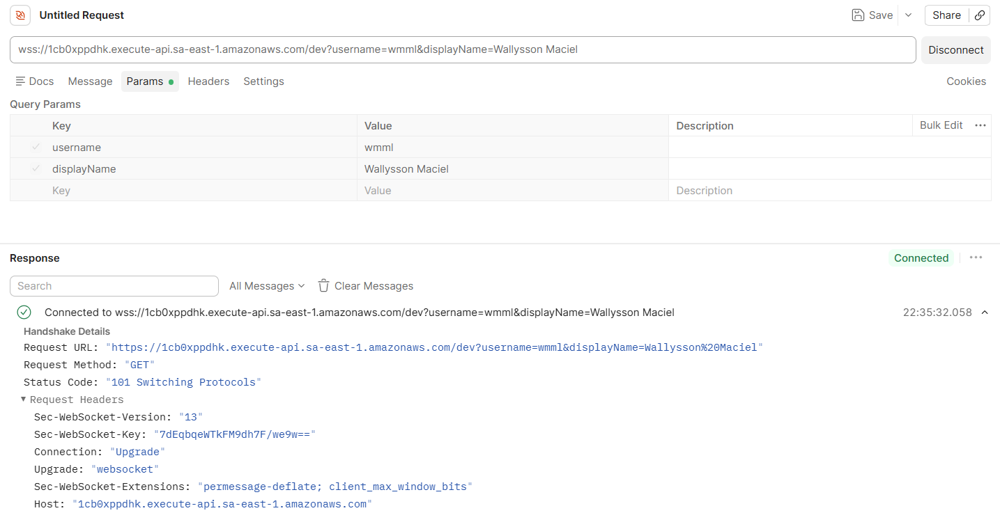
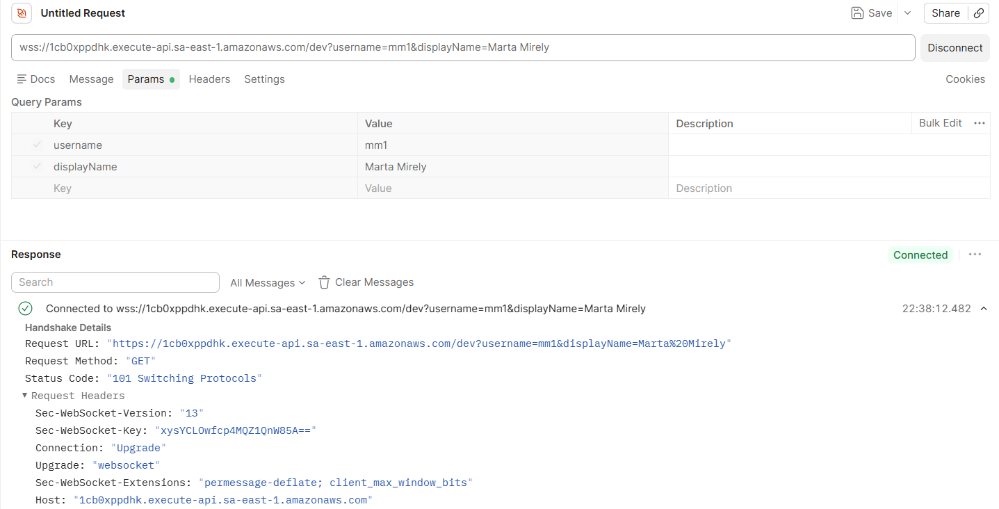
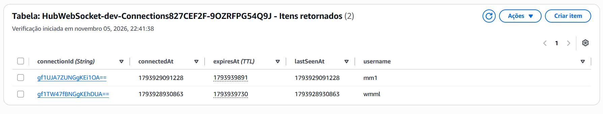
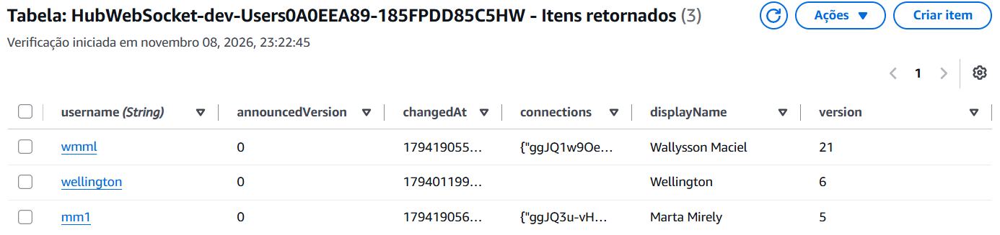
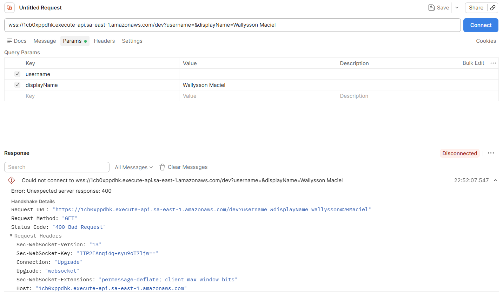
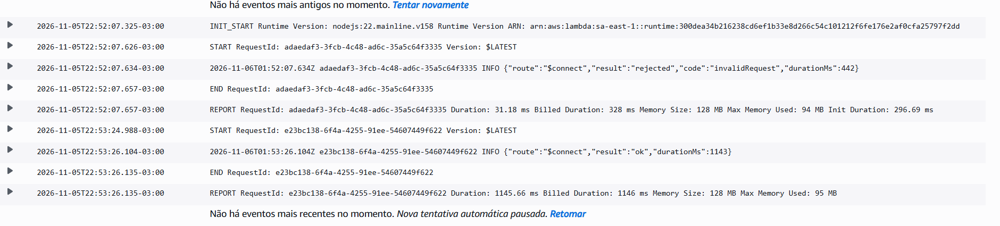
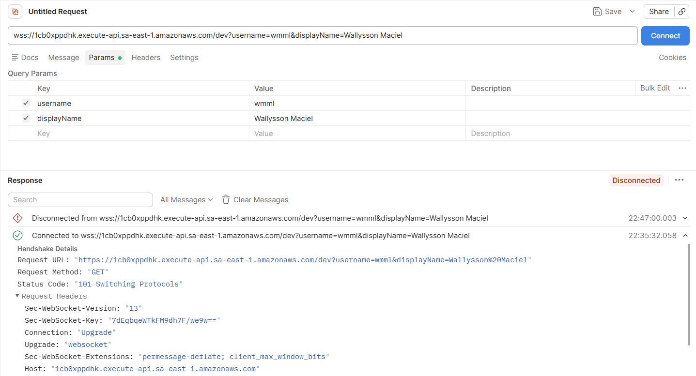
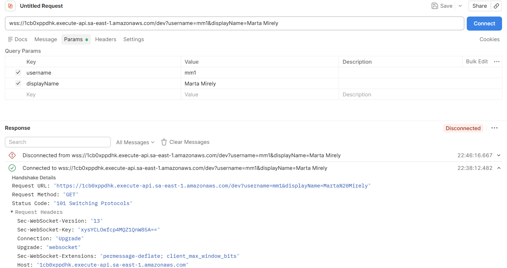
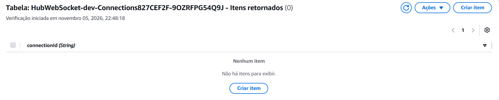
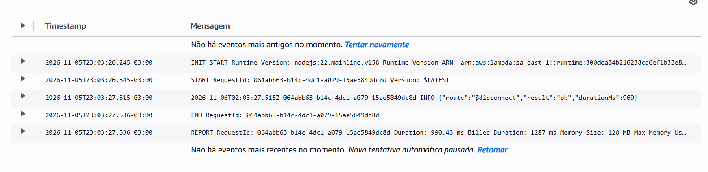

# Evidências de Teste
**Projeto:** Hub Colaborativo WebSocket

## T1: Conexão e Registro
**Item 1:** Conexão e Registro de Múltiplos Usuários  
**Descrição:** Conectar dois usuários que tenham uma conversa entre si e confirmar que há um registro com o connectionId de cada um, associado ao respectivo usuário.  
**Status:** [x] Aprovado

**Status da Conexão:** Sucesso (`101 Switching Protocols` no Postman). 

Conexão do cliente A:  
  

Conexão do cliente B:  
  

**Tabela DynamoDB:** `HubWebSocket-dev-Connections827CEF2F-9OZRFPG54Q9J`  
**Atributos Gravados:**  

| Cliente | Username | Connection ID | Connected At | Expires At (TTL) |
| :--- | :--- | :--- | :--- | :--- |
| **Cliente A** | `wmml` | `gf1TW47fBNGgKEhDUA==` | `1793928930863` | `1793939730` |
| **Cliente B** | `mm1` | `gf1UJA7ZUNGgKEi10A==` | `1793929091228` | `1793939891` | 

Confirmação de itens gravados na DynamoDB:
  

Confirmação dos `displayNames` Conectados na Tabela Users:
 

**Item 2:** Validação de Parâmetros Obrigatórios `($connect)`  
**Descrição:** Tentar conectar sem nome de usuário e confirmar que a conexão é recusada  
**Status:** [x] Aprovado

Confirmação de recusa de conexão no Postman através de `Status Code: "400 Bad Request"`:  

 

Confirmação através da linha 3 `2026-11-06T01:52:07.634Z adaedaf3-3fcb-4c48-ad6c-35a5c64f3335 INFO {"route": "$connect", "result": "rejected", "code": "invalidRequest", "durationMs": 442
}`do CloudWatch:  

  

**Item 3:** Alteração do Nome de Exibição  
**Descrição:** Com um dos usuários aberto em uma única aba, trocar o nome de exibição dele e confirmar que o outro usuário vê o novo nome imediatamente e, pelos logs do cliente do outro usuário, que ele não recebe nenhum anúncio do usuário como offline.  
**Status:** [ ] Pendente (Aguardando implementação backend)

**Item 4:** Persistência Local e Reconexão  
**Descrição:** Abrir uma segunda aba desse usuário no mesmo navegador, sem informar o nome de exibição, e confirmar que o outro usuário continua vendo o novo nome. Trocar o nome de novo na segunda aba e fechá-la; desligar a rede da máquina até a primeira aba indicar a queda da conexão, religá-la e, depois que os clientes que perderam a conexão indicarem a volta dela, confirmar que o outro usuário vê o último nome.  
**Status:** [ ] Pendente (Aguardando implementação no backend)  

**Item 5:** Encerramento de Conexão e Sincronização de Sessão
**Descrição:** Abrir de novo uma segunda aba desse usuário, sair do cliente em uma das abas e confirmar que a outra também sai. Entrar em uma das abas com um terceiro usuário e confirmar que a outra entra com ele.  
**Status:** [ ] Pendente (Aguardando implementação no backend)

**Item 6:** Encerramento de Conexão e Descarte de Registros `($disconnect)`  
**Descrição:** Desconectar os clientes e confirmar que os registros foram removidos; o da conexão interrompida no passo 4 pode ser removido só pela expiração por inatividade (RF07).  
**Status:** [x] Aprovado

Cliente A desconectado com sucesso através da interface do Postman:
  

Cliente B desconectado com sucesso através da interface do Postman:
  

Tabela Connections do DynamoDB sem registos ativos após o encerramento das conexões:
  

A desconexão por inatividade é evidenciada na linha 3 pela `"route":"$disconnect"` na CloudWatch:  
