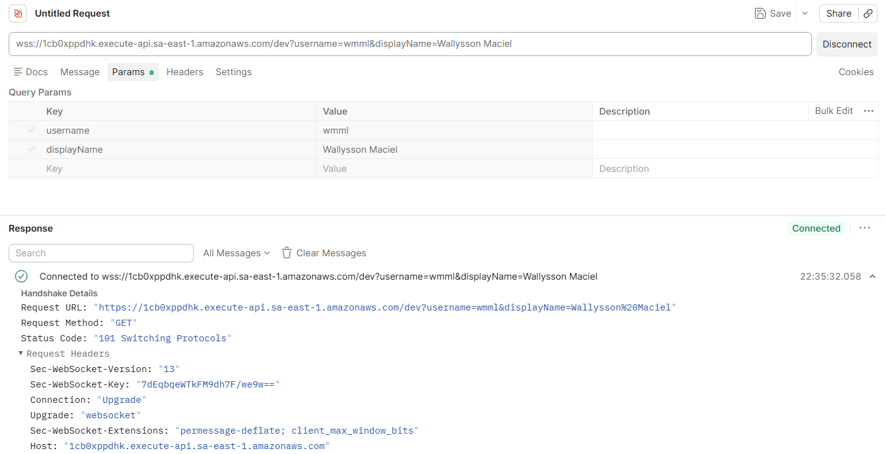
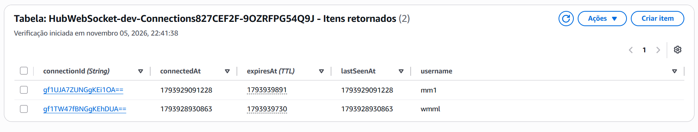
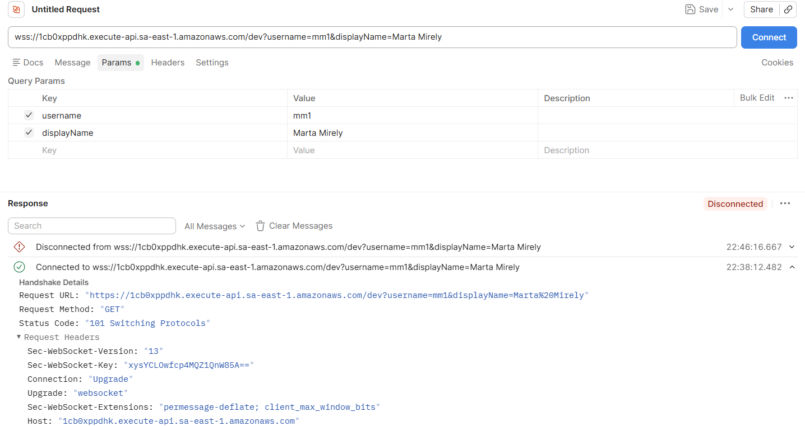
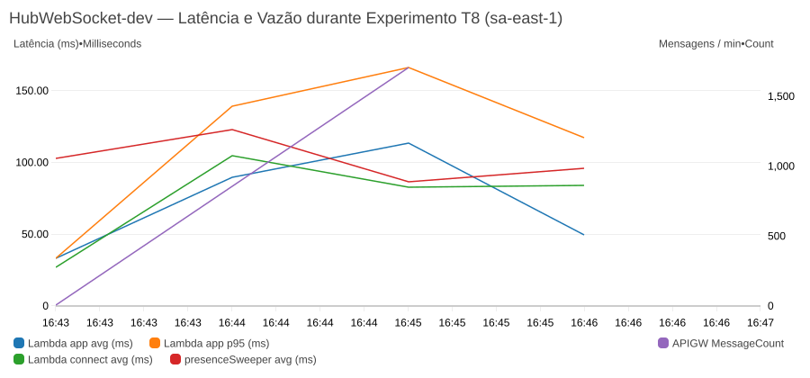

# Evidências de Teste

**Projeto:** Hub Colaborativo WebSocket

## T1: Conexão e Registro

**Item 1:** Conexão e Registro de Múltiplos Usuários  
**Descrição:** Conectar dois usuários que tenham uma conversa entre si e confirmar que há um registro com o connectionId de cada um, associado ao respectivo usuário.  
**Status:** [x] Aprovado

**Status da Conexão:** Sucesso (`101 Switching Protocols` no Postman).

Conexão do cliente A:  


Conexão do cliente B:  


**Tabela DynamoDB:** `HubWebSocket-dev-Connections-<id>`  
**Atributos Gravados (identificadores anonimizados):**

| Cliente       | Username   | Connection ID       | Connected At    | Expires At (TTL) |
| :------------ | :--------- | :------------------ | :-------------- | :--------------- |
| **Cliente A** | `<user-a>` | `<connection-id-a>` | `1793928930863` | `1793939730`     |
| **Cliente B** | `<user-b>` | `<connection-id-b>` | `1793929091228` | `1793939891`     |

Confirmação de itens gravados na DynamoDB:


Confirmação dos `displayNames` Conectados na Tabela Users:


**Item 2:** Validação de Parâmetros Obrigatórios `($connect)`  
**Descrição:** Tentar conectar sem nome de usuário e confirmar que a conexão é recusada  
**Status:** [x] Aprovado

Confirmação de recusa de conexão no Postman através de `Status Code: "400 Bad Request"`:


Confirmação através da linha 3 `2026-11-06T01:52:07.634Z adaedaf3-3fcb-4c48-ad6c-35a5c64f3335 INFO {"route": "$connect", "result": "rejected", "code": "invalidRequest", "durationMs": 442
}`do CloudWatch:


**Item 3:** Alteração do Nome de Exibição  
**Descrição:** Com um dos usuários aberto em uma única aba, trocar o nome de exibição dele e confirmar que o outro usuário vê o novo nome imediatamente e, pelos logs do cliente do outro usuário, que ele não recebe nenhum anúncio do usuário como offline.  
**Status:** [x] Aprovado (validado ao vivo em Chromium contra o CloudFront/`dev` via reconexão paralela `HubSocket.reconnectInParallel` — propagação imediata ao contato B com 0 eventos `offline`, e coberto em Vitest)

**Item 4:** Persistência Local e Reconexão  
**Descrição:** Abrir uma segunda aba desse usuário no mesmo navegador, sem informar o nome de exibição, e confirmar que o outro usuário continua vendo o novo nome. Trocar o nome de novo na segunda aba e fechá-la; desligar a rede da máquina até a primeira aba indicar a queda da conexão, religá-la e, depois que os clientes que perderam a conexão indicarem a volta dela, confirmar que o outro usuário vê o último nome.  
**Status:** [x] Aprovado (validado ao vivo em Chromium: recarga F5 e 2ª aba restauram automaticamente via `hub:current-user` e `displayName` salvo em `localStorage`, sincronizados via evento `storage`, e reconectam com o último nome após queda/volta de rede)

**Item 5:** Encerramento de Conexão e Sincronização de Sessão  
**Descrição:** Abrir de novo uma segunda aba desse usuário, sair do cliente em uma das abas e confirmar que a outra também sai. Entrar em uma das abas com um terceiro usuário e confirmar que a outra entra com ele.  
**Status:** [x] Aprovado (validado ao vivo em Chromium com duas abas no mesmo contexto: logout na aba 1 desconecta e redireciona ambas para `/entrar` via evento `storage`; login com terceiro usuário na aba 1 entra automaticamente na aba 2)

**Item 6:** Encerramento de Conexão e Descarte de Registros `($disconnect)`  
**Descrição:** Desconectar os clientes e confirmar que os registros foram removidos; o da conexão interrompida no passo 4 pode ser removido só pela expiração por inatividade (RF07).  
**Status:** [x] Aprovado

Cliente A desconectado com sucesso através da interface do Postman:


Cliente B desconectado com sucesso através da interface do Postman:


Tabela Connections do DynamoDB sem registos ativos após o encerramento das conexões:


O encerramento da conexão pelo API Gateway é evidenciado na linha 3 pela `"route":"$disconnect"` no CloudWatch (já a expiração ativa de conexões inativas sem `$disconnect` é registrada com `"route":"presenceSweeper"`, validada no caso `S5-T7-SWEEPER` abaixo):


## Bateria automatizada de integração no estágio `dev` (T2, T3, T4, T5, T6, T7, segurança e logs)

Executada em `2026-11-21T16:58:34Z` contra `HubWebSocket-dev` (`sa-east-1`) via [scripts/integration-tests-dev.mjs](../scripts/integration-tests-dev.mjs), com relatório completo em [docs/dados/integration-report-dev.json](dados/integration-report-dev.json). Resultado geral: **12/12 aprovados**.

| Caso             | Escopo                                                                                                                                                                                                                                                   | Resultado    |     Duração |
| ---------------- | -------------------------------------------------------------------------------------------------------------------------------------------------------------------------------------------------------------------------------------------------------- | ------------ | ----------: |
| `S4-T3-1`        | Chat privado oculto até 1ª mensagem (`conversationAdded` só após envio) e isolamento contra terceiro usuário                                                                                                                                             | [x] Aprovado |    463,5 ms |
| `S4-T3-2`        | Grupo (A + C), isolamento contra B, recusa `forbidden` a B (RNF01), entrada de B com histórico anterior, envio concorrente de 3 clientes com ordenação idêntica por `sk` (RNF04), saída e aviso `lastMember`                                             | [x] Aprovado |  1.950,5 ms |
| `S5-T7-1`        | Reenvio idempotente (RF12: mesmo `messageId` pelo mesmo remetente confirma sem duplicar ao destinatário) e reuso do mesmo `messageId` por outro remetente                                                                                                | [x] Aprovado |    784,7 ms |
| `S5-T7-2`        | Desconexão de B com anúncio `presence` (`online: false`, v2) em tempo real para A, envio enquanto offline, reconexão (`online: true`, v3) e recuperação via `sync(since)` + `getHistory(after)`                                                          | [x] Aprovado |  1.068,9 ms |
| `S4-T2-SIZE`     | Mensagem UTF-8 multibyte de `31.600 B` (próxima ao limite de 32 KB do RF11 / T2.5) entregue íntegra via `@connections` e retornada em `getHistory`                                                                                                       | [x] Aprovado |    306,1 ms |
| `S4-T4-SEARCH`   | Pesquisa normalizada em `pt-BR` (T4 / RF05): consulta sem acento (`joao antonio`) encontra usuário `João Antônio` com estado de presença                                                                                                                 | [x] Aprovado |    105,5 ms |
| `S4-T5-HISTORY`  | Histórico > 128 KB (`140.010 B` em 5 mensagens de ~28 KB) paginado integralmente em 5 páginas via `getHistory(before)` (T5.3 / RF06)                                                                                                                     | [x] Aprovado |  1.326,5 ms |
| `S5-T6-MULTITAB` | Presença multi-aba (T6 / RF07): 2 abas de B recebem mensagens; fechar a 1ª mantém `online: true` (v7); fechar a 2ª anuncia `online: false` (v8)                                                                                                          | [x] Aprovado |    852,1 ms |
| `S5-T7-410-GONE` | **Tratamento real de `410 Gone` (`GoneException`)** (T7.1 / RF08 / Tema 4 item 4): conexão real encerrada e regravada em `Connections`/`Users`; envio dispara `410 Gone`, remove o registro morto, confirma ao remetente e anuncia `online: false` (v12) | [x] Aprovado |  5.715,7 ms |
| `S5-T7-SWEEPER`  | **Expiração real por inatividade no `presenceSweeper` (> 10 min)** (T7.2 / RF07): registro ocioso há 11 min é removido no tick do EventBridge Scheduler e anuncia `online: false` (v4) ao contato                                                        | [x] Aprovado | 48.012,1 ms |
| `S6-SEC-1`       | Rejeição de 5 handshakes inválidos no `$connect` (vazio, curto, espaço, quebra de linha `Ana%0ABia` e controle bidi `Ana%E2%80%AEBia`) e erro `unknownAction` na `$default` para ação desconhecida e payload não-JSON                                    | [x] Aprovado |  1.338,8 ms |
| `S6-LOGS-1`      | Auditoria em tempo real no CloudWatch Logs (`appLogs` com 45 linhas JSON estruturadas + `presenceSweeperLogs`): zero vazamentos de `username`, `conversationId` ou texto; hashes HMAC-SHA256 de 12 hex confirmados                                       | [x] Aprovado |  6.812,9 ms |

### Amostra real exportada do CloudWatch Logs (`S6-LOGS-1`, RNF03)

```json
{"route":"sendMessage","result":"ok","connectionId":"fba1f768139c","username":"97e128a955a0","conversationId":"ecf218703221","durationMs":127}
{"route":"sendMessage","result":"duplicate","connectionId":"fba1f768139c","username":"97e128a955a0","conversationId":"ecf218703221","durationMs":64}
{"route":"sendMessage","result":"error","code":"forbidden","connectionId":"8ce56bead886","username":"a4471b23417f","conversationId":"a4610d84ee9d","durationMs":37}
{"route":"presenceSweeper","result":"ok","durationMs":104}
```

### Painel CloudWatch durante o experimento T8 (RNF06)



## Validação E2E em navegador real (Chromium sobre CloudFront HTTPS — T1, T4, RF01, RF08 e WCAG AA)

Validado em Chromium headless contra a URL pública HTTPS da distribuição CloudFront (`HubWebSocket-dev`, `Content-Security-Policy` estrita sem erros de console nem violações CSP, zero erros HTTP >= 400 e `h1Count = 1` no desktop):

- **RF01 / T1.3–T1.5:** troca de `displayName` em tempo real via reconexão paralela propagada ao contato B sem nenhum evento `offline`; recarga (F5) e abertura de 2ª aba restaurando sessão automaticamente; saída em uma aba desconectando e redirecionando ambas para `/entrar` via evento `storage`; entrada com 3º usuário sincronizando ambas as abas.
- **RF05 / UX / RF08:** busca sem acento (`joao antonio`) encontrando `João Antônio`; clique em área não-focável da `SearchBox` mantendo o painel aberto; estado vazio acessível (`Nenhuma pessoa encontrada.`) no `PeoplePicker`; detecção rápida de offline via evento `offline` da `window`, bloqueio de navegação por teclado (`tabindex="-1"`) em conversas esmaecidas e retorno automático com `Conectado novamente.`.
- **T2.6–T2.9 e T7.4 (injeção de falhas e `beforeunload`):** cobertos de forma determinística pelas suítes automatizadas (`backend/test/` com 109 testes Jest e `frontend/src/**/*.spec.ts` com 181 testes Vitest).
