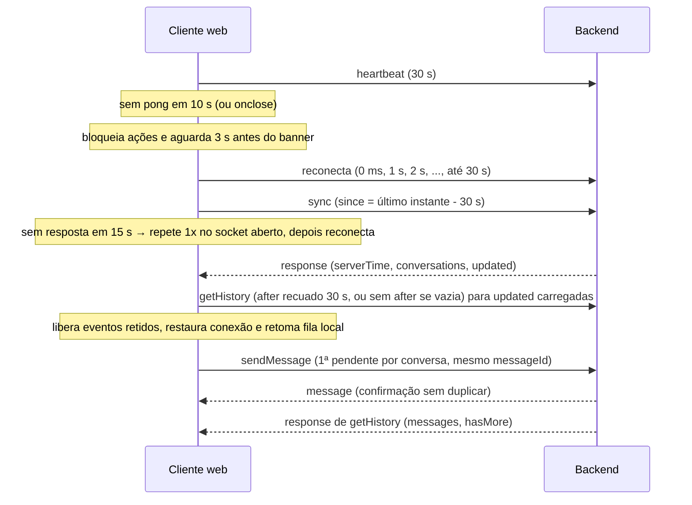

# Tolerância a falhas

**Projeto:** Hub Colaborativo WebSocket

## 1. Introdução

Este documento explica como o sistema lida com falhas parciais nos dois lados da comunicação: clientes que caem sem avisar, envios para conexões encerradas, Lambdas interrompidas no meio de um procedimento, falhas isoladas durante uma difusão, conexões sem registro, confirmações perdidas e quedas de rede no cliente web. Os nomes, as tabelas, os procedimentos e as decisões (D) citados estão na [arquitetura](arquitetura.md), que continua sendo a referência, e os requisitos, os riscos e os testes (RF, R e T), na [especificação](especificacao.md).

Em um sistema distribuído, o servidor não consegue distinguir um cliente lento de um cliente que caiu, e o cliente nem sempre recebe um fechamento limpo quando a rede cai. O backend combina o aviso do API Gateway (`$disconnect`), a resposta de cada envio (`410 Gone`) e o tempo desde a última requisição (`lastSeenAt` no `presenceSweeper`), enquanto o cliente combina o evento de fechamento do socket com o `heartbeat` periódico, reconecta com backoff exponencial e reconcilia o estado perdido.

## 2. Falhas consideradas

- **Queda do cliente sem `$disconnect`:** o API Gateway entrega o `$disconnect` em regime de melhor esforço, então uma queda de rede ou uma aba encerrada à força pode deixar a conexão no diretório e o usuário como online (R01).
- **Envio para uma conexão encerrada:** um `postToConnection` para uma conexão que não existe mais responde `410 Gone` (`GoneException`).
- **Lambda interrompida no meio:** um tempo limite ou um erro pode parar o vínculo ou o desvínculo entre passos ordenados (D09), ou interromper uma rota depois de gravar o estado e antes de avisar os clientes.
- **Falha de um único envio na difusão:** um envio pode falhar por outro motivo, como limite de requisições excedido, enquanto os demais destinatários da mesma difusão receberiam normalmente.
- **Conexão sem registro:** uma conexão ainda aberta pode enviar uma requisição depois de já ter sido desvinculada, por exemplo pela expiração por inatividade.
- **Confirmação perdida ou conflito no envio:** a conexão pode cair após a gravação da mensagem e antes da confirmação, ou o reenvio pode disputar o marcador com a tentativa original.
- **Queda silenciosa ou expiração da conexão no cliente:** uma perda de rede sem pacote de fechamento TCP ou o encerramento automático após 2 horas no API Gateway (L02) interrompem a entrega em tempo real até que o cliente reconecte e sincronize (R03, RF08).

## 3. Detecção de conexões órfãs (`410 Gone`)

Todo envio do backend a um cliente passa por `send` (`backend/functions/shared.ts`). Quando o API Gateway responde `410 Gone`, `send` aciona o procedimento único de desvínculo (seção 3.4 da arquitetura) e informa que o evento não foi entregue, sem lançar erro (RF08). Uma conexão encerrada sem `$disconnect` é detectada, assim, no primeiro envio dirigido a ela.

Como o id entra em `Users.connections` antes de o handshake terminar, um `postToConnection` nesse intervalo também responde `410`. Por isso, `unbind` ignora o `410` dentro do prazo de graça do `$connect` definido na seção 3.4 da arquitetura; se a conexão de fato caiu, o `$disconnect` ou o `presenceSweeper` a remove.

## 4. Difusão por conversa sem falhas em cascata

Na difusão de eventos de uma conversa (`fanOut`, em `backend/functions/data.ts`), cada entrega ocorre em paralelo e de forma independente:

- Um `410 Gone` desvincula só aquela conexão, e as demais recebem o evento normalmente (RF08).
- Qualquer outra falha também não interrompe os demais envios: `settle` (`backend/functions/shared.ts`) espera todas as entregas terminarem antes de relançar o erro, ou um `AggregateError` com todas as falhas quando mais de uma entrega falha, registrando os nomes distintos das exceções no log da execução — inclusive quando uma rota dispara duas difusões em paralelo, como `addMember` e `leaveGroup`. Sem isso, a primeira falha poderia encerrar a Lambda com envios ainda em andamento.

No `sendMessage`, a mensagem já foi gravada antes da difusão (seção 4.3 da arquitetura), então uma falha de entrega nunca a perde: quem não a recebeu em tempo real a recupera por `sync` e `getHistory` ao se reconectar.

## 5. Expiração por inatividade (`presenceSweeper`)

Conforme a seção 3.4 da arquitetura, toda requisição atualiza `Connections.lastSeenAt` (RF07), e o cliente envia `heartbeat` periódico para manter a conexão ativa e detectar quedas silenciosas (seção 4.4 da arquitetura). A Lambda `presenceSweeper` (`backend/functions/presenceSweeper.ts`) complementa esses sinais varrendo `Connections` e `Users` periodicamente (seção 3.4 da arquitetura, D05), com isolamento de falhas em dois níveis:

- **Leitura consistente e passagem única por minuto:** a varredura de `Connections` usa leitura fortemente consistente (`ConsistentRead: true`, seção 3.3 da arquitetura) para não tomar por inativa uma conexão que acabou de enviar requisição. Cada disparo a cada minuto do EventBridge Scheduler executa uma varredura de `Connections`, a varredura de `Users` e a publicação da métrica `OpenConnections` (tempo limite de 30 s), evitando manter um slot de concorrência Lambda ocupado dormindo em `setTimeout`.
- **Independência entre conexões e entre etapas:** uma falha ao encerrar a conexão com `DELETE @connections` é ignorada (ela pode já ter caído), e um desvínculo que falha não interrompe os demais nem cancela as etapas seguintes da execução (varredura de `Connections`, limpeza de órfãos e refeitura de anúncios em `Users` e publicação de `OpenConnections`). Na limpeza de órfãos, `sweepUsers` só dispensa o reanúncio pendente de um usuário quando `unbind` efetivamente removeu o id e anunciou o estado mais novo. Todas as falhas ocorridas são reunidas e relançadas ao final (como `AggregateError` quando há mais de uma) para registro no log, sem atrasar a remoção das demais conexões ou dos órfãos para o minuto seguinte.
- **Sem novas tentativas e TTL só como faxina:** o agendamento e a invocação assíncrona não repetem execuções que falharam, porque o disparo seguinte refaz o mesmo trabalho de forma idempotente sem disputar a cota de execuções simultâneas (D05). O TTL do DynamoDB atua apenas como faxina para registros que o sweeper não conseguiu tratar (seções 3.3 e 3.4 da arquitetura).

## 6. Recuperação após uma Lambda interrompida

A ordem fixa do vínculo e do desvínculo (D09 e seção 3.4 da arquitetura) impede que uma interrupção da Lambda no meio deixe um estado sem recuperação:

- Se a falha deixa um item em `Connections` (vínculo interrompido antes de concluir o handshake, ou desvínculo interrompido antes de apagar o item), o registro acaba removido pelo `410 Gone` em um envio ou pelo `presenceSweeper` após o prazo de inatividade.
- Se um id permanece em `Users.connections` sem item em `Connections` (por exemplo, se o TTL apagou o item antes do sweeper), a varredura de `Users` do `presenceSweeper` o identifica e confere a ausência com uma leitura consistente antes de desvincular; como um `Scan` não é um retrato de um único instante, essa conferência evita tomar por órfã uma conexão aberta durante a varredura (seção 3.4 da arquitetura).

## 7. Requisições de uma conexão sem registro

A atualização condicional de `lastSeenAt` (seção 3.4 da arquitetura) impede recriar o registro de uma conexão já desvinculada e barra a execução em sessões já removidas pelo backend. Como define essa seção, o `sendMessage` apenas encerra a conexão sem responder com erro — para que o cliente mantenha a mensagem na fila e a reenvie ao reconectar (RF12) —, enquanto as demais rotas respondem `notRegistered` antes de encerrar a conexão (RF08, RF09).

## 8. Reenvio sem duplicação

Para tolerar quedas entre a gravação da mensagem e a entrega da confirmação ao remetente, o `sendMessage` grava a mensagem e um marcador de idempotência na mesma transação (seções 3.3 e 4.3 da arquitetura, R07, RF12). O marcador `id#<sender>#<messageId>` recebe TTL de 7 dias (`expiresAt`) para evitar acúmulo indefinido sem afetar o item da mensagem (`m#…`), que permanece no histórico. Um reenvio encontra o marcador e confirma a mensagem apenas à conexão solicitante, refazendo os passos posteriores à transação caso uma execução anterior tenha sido interrompida.

Conflitos de transação, que acontecem quando um reenvio disputa o mesmo marcador com a tentativa original, seguem as retentativas da seção 3.3 da arquitetura; a atualização de `lastMessageAt` fica fora da transação justamente para que envios simultâneos na mesma conversa não disputem um item (R06). Se o conflito no marcador persistir, o backend deixa a mensagem sem confirmação, em vez de responder com erro, para que a fila do cliente a reenvie (seção 4.3 da arquitetura).

## 9. Heartbeat e reconexão no cliente

Para detectar quedas silenciosas além do evento de fechamento do socket (`onclose`), o `HubSocket` envia `heartbeat` e aguarda `pong` nos prazos definidos na seção 4.4 da arquitetura (RF08), enquanto o `SessionStore` escuta também os eventos `offline` (disparando uma sondagem imediata de `heartbeat`) e `online` (acordando o backoff de reconexão sem esperar o temporizador corrente) da `window`. Ao perder uma sessão já iniciada — ou se falhar ao restaurar uma sessão persistida em recarga ou nova aba —, o `SessionStore` aciona a reconexão automática; já uma falha na entrada manual pela tela `/entrar` (ao abrir o socket ou no `sync` inicial) é exibida na tela de entrada sem novas tentativas (seção 4.6 da arquitetura).

A recuperação segue backoff exponencial com primeira tentativa imediata (`0 ms`) e esperas crescentes (`1 s`, `2 s`, `4 s`, `8 s`, `16 s`, até o teto de `30 s`), registrando cada tentativa no console para auditoria dos testes (T7). Durante a queda, o `ConnectionStore` separa o bloqueio funcional da indicação visual:

- **Bloqueio imediato (`connected`):** torna-se falso assim que a queda é detectada, desabilitando as ações que dependem do backend listadas na seção 4.6 da arquitetura e mantendo disponível apenas o enfileiramento de mensagens (RF08, RF12).
- **Janela de tolerância (`lossIndicated` e `presenceVisible`):** o banner de queda e a ocultação da presença dos demais usuários só entram se o `sync` da reconexão não responder dentro dos 3 s definidos na seção 4.6 da arquitetura, evitando ruído em quedas breves como o limite de 2 horas do API Gateway (L02, RF07). Se a queda chegou a ser indicada, o retorno dispara a notificação de reconexão na interface (`reconnected`).

## 10. Recuperação de estado e fila local de reenvio

Antes mesmo de abrir o novo socket, o `SessionStore` coloca o `HubEvents` para reter eventos recebidos durante a abertura e o `sync` inicial da reconexão. O `sync` aplica a janela de sobreposição da seção 4.4 da arquitetura; se não houver resposta em 15 s com o socket ainda aberto, o cliente o repete uma vez antes de fechar a conexão e seguir o backoff (seção 4.6 da arquitetura).

Com a resposta do `sync`, o cliente atualiza a lista de conversas e, no `MessagesStore`, dispara `getHistory` para cada conversa já carregada listada em `updated` (com `after` recuado em 30 s, ou sem `after` se a conversa ainda não tiver mensagens, conforme a seção 4.4 da arquitetura) **antes** de liberar os eventos retidos pelo `HubEvents`. Essa ordem impede que uma mensagem recém-chegada no trânsito avance o cursor `after` para além do que foi perdido durante a queda. Se algum `getHistory` de recuperação falhar por nova queda, a conversa permanece registrada em `pendingSync` para ser retomada na reconexão seguinte, mesmo que não reapareça em `updated`. A sobreposição de 30 s é segura porque o `MessagesStore` mescla as mensagens por `(sender, messageId)` na ordem do `sk`, descartando duplicatas (RNF04).

Sem aguardar o término assíncrono do `getHistory`, o cliente libera os eventos retidos, restaura o estado conectado e aciona o reenvio da fila local em memória. As mensagens pendentes de cada conversa são reenviadas uma por vez, na ordem original, após o `sync` da reconexão ou após 15 s sem confirmação (seção 4.4 da arquitetura, RF12); uma recusa explícita do servidor (`error`) retira a mensagem da fila e libera a seguinte. Enquanto houver mensagens pendentes na aba, o `MessagesStore` intercepta fechamento e recarga via `beforeunload` e a saída do cliente pede confirmação; ao sair ou trocar de usuário, o evento `storage` avisa as demais abas do mesmo navegador, que descartam suas filas locais sem aviso (seção 4.6 da arquitetura).
